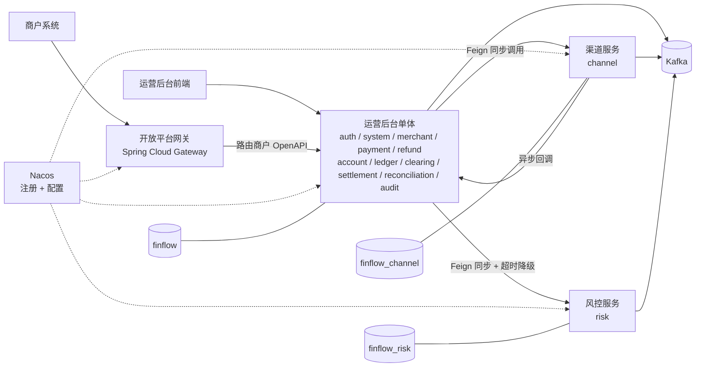

# FinFlow 微服务演进执行报告（Spring Cloud Alibaba 落地版）

## 一、先读这里

**这份报告解决什么问题**

当前项目是模块化单体（Modular Monolith），S01–S42 已完成。目标是在**不破坏资金强一致性**的前提下，把"变化速率不同、外部依赖不同、访问主体不同"的三类业务拆成独立部署单元，让 Spring Cloud Alibaba 的每个组件都有业务出处，而不是先装框架再找理由。

**结论先行**

* 最终形态是 **4 个必选部署单元 + 2 个可选**，不是十几个服务。
* 支付资金核心（payment / refund / account / ledger）**不拆**。
* Spring Cloud Alibaba 从 M08 才开始出现，前面 7 步一个组件都不用。

**编号说明**

本报告用 M01–M17，接在 S01–S41 之后，避免和已有步骤混淆。每一步只做一件事，做完单体仍能启动、全量测试仍绿。

**关于 S42**：S42 是可选的"拆出异步任务 Worker"实验，**不再执行**。它要拆的定时任务（结算 / 对账 / 超时关单 / Webhook 重试）已被 M16 与 M17 覆盖，先做 S42 会与后续步骤重复。因此本报告的起点是"S41 交付完成"，等价于上一版的 S42 前置。

**三条贯穿全程的铁律**

| # | 铁律 |
| - | --- |
| 1 | 一次只拆一个服务，拆完观察，再动下一个 |
| 2 | 资金主链路（支付 / 退款 / 账户 / 流水）保持同库同事务 |
| 3 | 每一步都要能回退：任何服务拆出去后，都能一键回到单体进程内调用 |

***

## 二、目标架构

**四个必选单元**

| 单元 | 角色 | 独立它的理由 |
| --- | --- | --- |
| 运营后台单体 | 运营后台 + 资金主链路 + 清分结算对账 | 资金一致性要求最高，拆开只剩分布式事务 |
| 开放平台网关 | 商户 OpenAPI 统一入口 | 访问主体是商户，鉴权体系、限流策略、SLA 与运营后台完全不同 |
| 渠道服务 | 第三方渠道适配 | 外部协议变更频繁、第三方不稳定，需要故障隔离与独立发布 |
| 风控服务 | 规则决策 | 规则运营节奏与支付发布节奏不同，需要独立灰度与扩容 |

**两个可选单元**

| 单元 | 角色 | 什么时候值得拆 |
| --- | --- | --- |
| 通知服务 | Webhook + 站内信 + 邮件 | 外部回调慢，已经拖慢主链路时 |
| 批处理服务 | 清分 / 结算 / 对账 | 夜间批处理与在线支付争抢资源时 |

**数据边界**

* `finflow`：运营后台单体全部表
* `finflow_channel`：渠道配置、渠道交互记录、渠道健康度
* `finflow_risk`：规则、名单、决策日志
* `finflow_notify`（可选）
* 禁止跨 schema join，跨库数据一律走接口或事件投影

***

## 三、模块重新分配

### 现有 15 个模块的去向

| 现有模块 | 去向 | 说明 |
| --- | --- | --- |
| `auth` | 运营后台单体 | 后台 JWT/RBAC；商户侧鉴权走网关的 AK/SK，两套体系不混用 |
| `system` | 运营后台单体 | 用户 / 角色 / 菜单 / 系统配置 |
| `merchant` | 运营后台单体 | 商户档案、费率、结算账户、密钥管理（**密钥存在后台，验签在网关**） |
| `payment` | 运营后台单体 | 资金主链路，保留本地事务、状态机、幂等 |
| `refund` | 运营后台单体 | 与支付同事务边界 |
| `account` | 运营后台单体 | 余额与冻结必须与流水同事务 |
| `ledger` | 运营后台单体 | 只增不改 |
| `risk` | **风控服务** | 规则热更新、决策日志、独立扩容 |
| `clearing` | 运营后台单体（后期可迁批处理） | 依赖资金数据，先不动 |
| `settlement` | 运营后台单体（后期可迁批处理） | 同上 |
| `reconciliation` | 运营后台单体（后期可迁批处理） | 同上 |
| `webhook` | 通知服务（可选） | 纯异步消费，不构成引入 Spring Cloud Alibaba 组件的理由 |
| `notification` | 通知服务（可选） | 同上 |
| `audit` | 运营后台单体 | 后台审计落库；各服务写自己的接入日志 |
| `common` | 共享 starter + contract | 统一响应、错误码、幂等、事件契约 |

### 新增能力及其落点

| 新增能力 | 落在哪个单元 | 为什么放这里 |
| --- | --- | --- |
| 商户 OpenAPI（下单 / 查单 / 退款 / 关单） | 网关 | 对外契约需要稳定，不能被后台内部接口变更带偏 |
| AK/SK 签名、时间戳 + nonce 防重放 | 网关 | 与后台 JWT 是两套鉴权，不该混在 auth 模块里 |
| 按商户/接口维度的限流与配额 | 网关 | 保护后端，同时是商户套餐的计费依据 |
| IP 白名单、请求审计日志、统一错误码映射 | 网关 | 接入层职责 |
| 多渠道协议适配（微信 / 支付宝 / 银联风格） | 渠道服务 | 协议细节与支付业务解耦，可复用 `finflow-fake-channel` 联调 |
| 渠道参数与证书管理、渠道健康度、自动降级 | 渠道服务 | 第三方不稳定，需要独立熔断与切流 |
| 渠道回调统一验签与接入 | 渠道服务 | 外部异步入口收敛到一处 |
| 规则热更新与灰度、黑白名单、限额、频率控制 | 风控服务 | 规则运营频率高，不能跟着支付一起发版 |
| 决策接口与决策日志 | 风控服务 | 支付只需一个同步决策调用，超时后按策略降级 |

***

## 四、Spring Cloud Alibaba 组件与引入时机

选型说明：注册与配置用 Nacos、流控与熔断用 Sentinel（这两块来自 Spring Cloud Alibaba）；网关、Feign、负载均衡仍用 Spring Cloud 原生组件，版本统一由 SCA 的 BOM 管理，避免版本互相打架。

| 组件 | 归属 | 引入步骤 | 业务理由 |
| --- | --- | --- | --- |
| Nacos Discovery | SCA | M08 | 出现第二个服务，地址不能再写死在配置文件 |
| OpenFeign | Spring Cloud | M08 | payment 需要同步调用渠道服务发起支付/退款 |
| Spring Cloud LoadBalancer | Spring Cloud | M08 | 渠道服务多实例、按健康度分流 |
| Sentinel（流控 / 熔断 / 降级） | SCA | M08、M11 | 渠道是外部依赖、风控是同步阻塞点，都必须有超时预算与降级策略 |
| Spring Cloud Gateway | Spring Cloud | M13 | 商户需要独立对外入口，做签名、限流、白名单、路由 |
| Nacos Config | SCA | M14 | 渠道参数、风控阈值、限流阈值要热更新，且多环境隔离 |
| Micrometer Tracing + OTel | Spring Boot | M15 | 4 个进程后，排障必须靠一条 traceId 串起来 |
| Seata | SCA | 不默认引入 | 资金核心未拆库，没有跨服务事务需求；若后续批处理跨库确有必要，再评估 AT 模式 |
| RocketMQ | SCA | 不引入 | Kafka 已在使用且满足事件驱动需求，不为此换中间件 |
| Dubbo | SCA | 不引入 | 服务间调用用 OpenFeign 已足够，多一套 RPC 协议只增加维护面 |
| Spring Cloud Stream / Bus | Spring Cloud | 不引入 | Kafka 直用已足够，多 binder 抽象在这个项目里没有收益 |

***

## 五、分步任务

### 阶段 0：版本与边界基线（M01–M05）

#### M01 版本对齐与最小骨架验证

* **范围**：环境与版本，不碰业务
* **前置**：S41 完成（S42 已取消，见"关于 S42"）
* **做什么**
  * 锁定 Spring Cloud Alibaba 版本：SCA 版本、Spring Cloud release train、Spring Boot 主版本三者必须对齐；Boot 4.1 若尚无对应 SCA 版本，以 SCA 支持的 Boot 版本为准
  * 引入 `spring-cloud-alibaba-dependencies` BOM，统一管理 Spring Cloud 与 SCA 各组件版本
  * docker compose 增加 Nacos 单机容器（注册 + 配置）
  * 建一个空 Gateway 工程，能启动、能注册到 Nacos、能连上 Sentinel 控制台
* **不做**：不接任何业务接口，不引 Feign
* **完成标志**：版本矩阵落文档，空网关在 Nacos 控制台可见

#### M02 依赖体检

* **范围**：整个后端工程
* **前置**：M01
* **做什么**
  * 引入 ArchUnit，写三条规则：模块不得引用他人的 mapper/entity；controller 不得反向调用其他模块 service；common 不得依赖业务模块
  * 跑一遍，产出模块违规依赖清单
* **不做**：不改代码、不改表
* **完成标志**：清单可读，能看出 channel / risk 两块的实际耦合点

#### M03 模块对外 facade

* **范围**：跨模块调用方式
* **前置**：M02
* **做什么**
  * 每个模块建 `api` 包，只放 interface + DTO
  * 所有跨模块调用改走 `api`，实现类留在模块内部
* **不做**：不动业务逻辑，不重构 service 内部
* **完成标志**：模块依赖只指向对方 `api` 包

**M03 实测结论（2026-10-30）**：**已执行**（M04 未动）。

* **api 包落地**：14 个业务模块各建 `api` 包，只放接口 + DTO/枚举；内部 Service 接口 `extends` 同名 api 接口复用方法声明（`PaymentOrderService`/`MerchantService`/`RateService`/`ApiKeyService`/`ConfigService`/`RbacAuthorityService`/`FileObjectService`/`AuthService`），实现类与实体全部留在模块内部。
* **跨模块只传快照**：新增 `AccountSnapshot`/`PaymentOrderSnapshot`/`ClearingOrderSnapshot`/`LedgerEntry`，结算、清分、退款、对账不再跨模块传 entity；`AccountApi.getOrCreate` 返回快照，实体读取 `getAccount` 降为模块内部方法。
* **共享上下文上移**：`CurrentUser`/`CurrentUserHolder` 提到 `common.context`；`Audited`、`ConfigKeys`、`MenuTreeNode`、`FileBizType`、`FileObjectResponse` 随各自 api 包迁移，调用方只认 api。
* **同名重复定义清零**：删除 `payment.PaymentStatus`、`payment.channel.{PaymentChannel,ChannelRequest,ChannelResult,RefundResultHandler}`、`payment.risk.{RiskChecker,RiskCheckContext}`、`refund.RefundErrorCode` 等 api 包里的复制品，全工程同名类型只保留一份。
* **调用方改造**：所有跨模块依赖改为注入 api 类型（`AccountApi`/`LedgerApi`/`PaymentOrderApi`/`PaymentTransactionApi`/`ChannelConfigApi`/`PaymentProcessApi`/`RateApi`/`MerchantApi`/`ApiKeyApi`/`ConfigApi`/`RbacAuthorityApi`/`AuditApi`/`AuthApi`/`ClearingQueryApi`/`FileObjectApi`/`ChannelRouter`）；对账按 objectKey 回读改走 `FileObjectApi.openByObjectKey`，不再直连 `FileStorage`。
* **规则四**：ArchUnit 增补 `rule-4-cross-module-only-via-api`（引用其他模块非 api 包即违规），冻结基线只剩 8 个 `.event` 包引用（clearing/ledger/notification/payment/reconciliation/refund/risk/settlement），交由 M04 收口；`rule-1` 基线已清零（0 字节）。
* **验证**：`compile` + `test-compile` 通过，`ModuleBoundaryTest` 四条规则全绿；全量测试 311 个单测通过、0 失败，50 个集成用例因本机 Docker 未启动（Testcontainers 找不到 Docker 环境）未能执行，与本次改动无关。

#### M04 事件契约独立

* **范围**：Kafka 事件的契约
* **前置**：M03
* **做什么**
  * 新建 `contract` 模块：topic 常量、事件 payload、`version` 字段
  * 生产者与消费者统一引用，语义只增不改
* **不做**：不新增事件，不改消费逻辑
* **完成标志**：topic 字符串在整个工程内只出现在 contract 里

**M04 实测结论（2026-10-31）**：**已执行**（M05 未动）。

* **contract 落点**：新增 `contract` 包，含 `EventTopics`（7 个 topic 常量）、`EventTypes`（7 个事件类型）、`DomainEvent`（信封：eventId / eventType / occurredAt / version / payload）与 7 个 payload record。`finflow.*` topic 字面量在整个工程只剩 `EventTopics` 一处（测试注释已改为引用常量说明）。
* **生产 / 消费统一引用**：`PaymentEventPublisher`、`RefundEventPublisher`、`SettlementStatusService`、`RiskEngine`、`ReconciliationMatchService` 与 clearing / ledger / webhook / notification / payment 事件日志消费者全部改引 contract；删除模块内 13 个 `*Topics` / `*Payload` 副本与 `common.event.DomainEvent`，webhook 本地重复的 `RefundPayload` 一并删除，未新增事件、未改消费逻辑。
* **version 契约**：`CURRENT_VERSION = 1`；新增字段不升版本，删除或改语义才升版本并新建 payload 类型。存量报文缺 `version` 时 Jackson 反序列化为 null，记录构造归一为 0（视为 v1 之前报文）；字段用 `Integer` 只为容忍缺省，实例中恒非空。
* **规则五**：新增 `rule-5-contract-is-leaf`，contract 只能依赖 JDK 与自身，保证契约包可独立发布。
* **边界收尾**：规则体检暴露 3 处残留的非 api 注入（`AuthController` → `RbacAuthorityService`、`LedgerService` → `AuditRecorder`、`PaymentOrderServiceImpl` → `MerchantService` / `ConfigService`），已分别改注入 `RbacAuthorityApi` / `AuditApi` / `MerchantApi` / `ConfigApi`；`RefundServiceImpl` 改用 `PaymentOrderSnapshot` 访问器。四份冻结基线（rule-1 ~ rule-4）全部清零（0 字节），五条规则全绿；M03 遗留的 rule-4 `.event` 引用随 contract 收口一并消失。
* **杂项修复**：3 个文件（`PaymentLedgerConsumer` / `RefundLedgerConsumer` / `SettlementPostingService`）带 UTF-8 BOM 导致 javac 报 `非法字符 '\ufeff'`，已去 BOM。
* **验证**：`compile` + `test-compile` 通过；`ModuleBoundaryTest` 5/5 通过；M04 相关单测全部通过（PaymentEventLogConsumerTest 2、ClearingEventConsumerTest 6、RiskEngineVerdictTest 6、ReconciliationMatchServiceTest 5、NotificationEventConsumerTest 6、PaymentProcessServiceTest 9、PaymentOrderServiceImplTest 15、RefundServiceImplTest 10、WebhookDeliveryServiceTest 5）。集成用例仍依赖本机 MySQL / Redis / Kafka，未纳入本次验收。

#### M05 表归属与跨模块访问清单

* **范围**：数据归属
* **前置**：M04
* **做什么**
  * 给每张表标注所属模块，输出"表 → 模块"清单
  * 标出所有跨模块直接读表 / join 的位置
* **不做**：不迁移任何表
* **完成标志**：没有归属不明的表，channel / risk 的表已明确归属

**M05 实测结论（2026-10-31）**：**已执行**（只盘点、未迁移任何表）。完整清单见 [FinFlow表归属清单.md](FinFlow表归属清单.md)。

* **表 → 模块**：43 张表全部有唯一实体（`@TableName`），无孤儿表、无归属不明的表；`contract` / `common` 不持有表。按模块为 auth 3、system 7、audit 1、merchant 7、payment 5、refund 2、account 1、ledger 1、clearing 2、settlement 3、reconciliation 4、risk 3、webhook 2、notification 2。
* **channel / risk 归属**：`payment_channel` / `payment_transaction` 明确归 payment 的渠道域（M06 收敛能力、M07 迁 `finflow_channel`），`payment_callback` 归 payment 不迁；`risk_rule` / `risk_event` / `risk_blacklist` 归 risk。
* **运行时跨模块直接读表**：共 2 处。`ReconciliationMatchMapper.insertMatchResults` 只读 join `payment_order` / `refund_order` / `payment_transaction` / `payment_order_state_log`；`DashboardStatsMapper` 10 个只读查询跨 `payment_order` / `refund_order` / `settlement_order` / `clearing_order` / `risk_event` / `merchant`。两处均无写入。
* **迁移期跨模块触表（附注）**：20 个业务脚本向 `sys_permission` / `sys_menu` 追加权限与菜单；跨模块 `ALTER` 4 处（V17 改 `account_ledger`，V18 改 `payment_order` + `account_ledger`，V20 改 `payment_channel`）；`merchant_tier_rate` 由 V20 创建但归 merchant。
* **数据形态**：43 张表同处 schema `finflow`，全库无外键，关联仅靠业务字段与索引；Java 层跨模块 `mapper` / `entity` 引用由 `ModuleBoundaryTest` 规则一~规则四零基线保证为 0。
* **遗留**：2 处运行时跨模块读表与迁移期跨模块 `ALTER` 维持现状（本步骤不迁移）；Flyway 按模块分目录从 M07 开始。

> 阶段出口：边界可验证、契约独立、表归属清楚，但系统仍是单体。

***

### 阶段 1：先拆渠道服务（M06–M08）

#### M06 渠道能力进程内解耦

* **范围**：`channel` 的能力收敛（进程内）
* **前置**：M05
* **做什么**
  * 把散在 payment 里的渠道路由、渠道调用、回调解析收敛进 channel 模块
  * payment 只依赖 channel 暴露的 `api`
* **不做**：不拆进程、不改表
* **完成标志**：payment 模块内不再出现任何渠道协议细节

**M06 实测结论（2026-10-31）**：**已执行**（进程内解耦，未拆进程、未改表结构，也未迁移 schema）。

* **新建顶层 `channel` 模块**：`api`（`ChannelAdapter` SPI、`ChannelRouter`、`ChannelRequest` / `ChannelResult`、`ChannelConfigApi`、`PaymentTransactionApi` + 快照、`ChannelErrorCode`）、`entity` / `mapper`（`PaymentChannel`、`PaymentTransaction`）、`config`（`RemoteChannelProperties`）、`service`（路由、渠道调用与签名、配置查询、交互记录）、`web`（`ChannelNotifyController`）。
* **收敛进 channel 的能力**：渠道路由（原 `PaymentChannelRouter`）、HTTP 渠道调用与 HMAC 签名（原 `RemoteChannel` / `RemoteBank` / `RemoteCard` / `RemoteWallet` / `ChannelSignatureService`）、回调验签与报文解析（原 `ChannelNotifyController`）、渠道配置与交互记录的读写。
* **留在 payment 的只有业务**：支付订单与状态机；回调业务处理由 `ChannelCallbackService` 收口为 `payment.api.ChannelCallbackApi`，channel 侧验签解析后构造 `ChannelCallbackCommand` 反向调用，payment 不再接触原始报文与签名。`RefundResultHandler` 上移至 `payment.api`，channel 不依赖 refund 实现。
* **错误码**：新增 `channel.api.ChannelErrorCode.CHANNEL_NOT_FOUND`（45001 / 409），删除 payment 内重复的 44005；路由失败语义统一由 channel 抛出。
* **依赖方向**：channel 只依赖 `payment.api`（回调业务入口）；payment / refund / clearing / reconciliation 只依赖 `channel.api`。`ModuleBoundaryTest` 的 `MODULES` 已加入 `channel`，渠道相关类随迁移一并纳入五条规则。
* **验证**：JDK 25 下 `mvn compile`、`mvn test-compile` 通过；`ModuleBoundaryTest` 5 条规则全绿，rule-1~rule-4 冻结基线仍为 0 字节（无新增跨模块违规）；渠道相关单测 62 个全绿（channel 14、payment 24、refund 10、clearing 6、reconciliation 8）；Testcontainers 集成测试 18 个类共 50 例全部通过（含渠道相关的 `PaymentChannelIntegrationTest`、`RefundIntegrationTest`、`ClearingIntegrationTest`、两个 reconciliation 集成测试；顺带补齐 `RefundLedgerConsumerTest` 缺失的平台账户入账前置，该用例此前既有失败）。payment 包内已无签名/验签、渠道 HTTP 协议、渠道表 mapper/entity 引用。
* **遗留**：表仍在 `finflow` schema，M07 再迁 `finflow_channel`。

#### M07 渠道数据分离

* **范围**：数据
* **前置**：M06
* **做什么**
  * 渠道配置表、渠道交互记录表迁到独立 schema `finflow_channel`（同实例）
  * Flyway 按模块分目录
* **不做**：不拆进程，不上配置中心
* **完成标志**：单体跑通，渠道两张表已在独立 schema

**M07 实测结论（2026-10-31）**：**已执行**（数据分离，未拆进程、未引入配置中心）。

* **Flyway 分目录**：`spring.flyway.locations` 改为 `classpath:db/migration,classpath:db/channel`，两目录共用同一张 history 表（单实例）；`db/channel` 后续脚本一律显式限定 `finflow_channel.`，首脚本已写入该约定注释。
* **V35 迁移**：`V35__move_channel_tables_to_channel_schema.sql` 先 `CREATE DATABASE IF NOT EXISTS finflow_channel`（utf8mb4 / unicode_ci），再跨库 `RENAME TABLE payment_channel / payment_transaction TO finflow_channel.*`。整表搬迁，不重建、不复制数据，索引与存量数据随表过去；V12（建表）、V20（补 `cost_rate_bps`）等历史脚本保持原样，校验和不受影响。
* **实体映射**：`PaymentChannel` / `PaymentTransaction` 的 `@TableName` 增加 `schema = "finflow_channel"`，由 MyBatis-Plus 生成带库名前缀的 SQL，业务代码不手写库名。
* **对账跨库读收口**：删除 `ReconciliationMatchMapper.insertMatchResults` 中读 `payment_transaction` 的 `MISSING_IN_CHANNEL` 片段；改为「主库候选 SQL（`selectMissingInChannelCandidates`）→ `channel.api.PaymentTransactionApi.findChannelOrderNos` 批量判定订单是否走过本渠道并取首条渠道单号 → 回填后批量写入 `reconciliation_record`」。对账不再直接读渠道库，符合「跨 schema 禁止 join、跨库只走 api」。
* **测试调整**：`IntegrationTestBase` 的 MySQL 容器改用 root（跨库 `RENAME` 需要目标库 CREATE / INSERT 权限，密码同为 test）；`PaymentChannelIntegrationTest` 断言 SQL 改用 `finflow_channel.payment_transaction`；`ReconciliationMatchServiceTest` 注入 `PaymentTransactionApi`，新增「非本渠道订单不写入 MISSING_IN_CHANNEL」用例。
* **验证**：JDK 25 下 `compile`、`test-compile` 通过；`ModuleBoundaryTest` 5/5、`ReconciliationMatchServiceTest` 6/6 通过；Testcontainers 全量 363 例中 361 通过（渠道 `PaymentChannelIntegrationTest` 2/2、`ReconciliationMatchIntegrationTest` 2/2，容器内 Flyway 正常应用 V35 跨库 `RENAME`）；dev 库启动应用，Flyway 由 v34 迁至 v35（`Migrating schema "finflow" to version "35 - move channel tables to channel schema"` → `now at version v35`），随后 `Started FinflowBackendApplication in 59.32 seconds`，Kafka 消费者正常分配分区。
* **遗留**：整包运行时 `SettlementExecuteIntegrationTest` 2 例 `ledgerService.consistencyCheck` 失败，单类运行 4/4 通过——属多个 IT 类共享同一 MySQL 容器与共享平台账户的既有测试隔离问题，与 M07 无关。本机 Docker 连接注意不要写死 `~/.testcontainers.properties` 里的 `docker.client.strategy`（Testcontainers 2.0.5 会把成功策略自动回写，Docker Desktop 29 下下次启动即失败），已清空并置只读、交由自动探测。生产需 DBA 预建 `finflow_channel` 并授予应用用户跨库 `RENAME` / 读写权限，或由 DBA 手工执行迁移。

#### M08 渠道服务独立进程

* **范围**：部署形态
* **前置**：M07
* **做什么**
  * 新建独立 Spring Boot 服务，注册到 Nacos
  * payment 通过 Feign 调用，用 Sentinel 配流控、熔断与降级（渠道不可用时切备用渠道或快速失败）
  * 补 Dockerfile 与 compose 编排
* **不做**：不同时动风控
* **完成标志**：渠道服务可单独启停，支付主链行为可预期

**M08 实测结论（2026-10-31）**：**已执行**（同源双进程，支付主链默认仍走进程内；渠道代码零复制）。

* **落地形态：同源双进程**。同一份源码、同一个 pom，额外产出 `finflow-backend-0.0.1-SNAPSHOT-channel.jar`（`spring-boot-maven-plugin` 增加 `repackage-channel-service` execution，`classifier=channel`、`mainClass=ChannelServiceApplication`）；默认主 jar 显式指定 `FinflowBackendApplication`（项目里出现两个 `@SpringBootApplication` 后，默认 repackage 无法再靠自动探测选主类）。两个进程共用一套渠道实现，靠配置切换，不复制代码。
* **契约与实现分离**。新增跨进程操作契约 `channel.api.ChannelOperationsApi`（`createPayment` / `queryPayment` / `refund` / `queryRefund`，入参统一 `ChannelRequest`，出参 `ChannelResult` 增加 `channelCode`）：业务拒绝返回 `accepted=false` 不抛异常，基础设施失败抛 `CHANNEL_SERVICE_UNAVAILABLE`（45002 / 503）。`ChannelRouter` / `ChannelAdapter` 降为 `channel.service` 内部 SPI，渠道选择留在渠道服务进程内，不再跨进程暴露。
* **一个开关两条路径**。`finflow.channel.mode=local|remote`：`local` 装配 `LocalChannelOperations`（默认，`matchIfMissing=true`，dev / 测试行为不变）；`remote` 由条件配置类 `ChannelRemoteConfig` 上的 `@EnableFeignClients(clients = ChannelOperationsClient.class)` 装配 Feign 客户端。`@ConditionalOnProperty` 直接挂在 `@FeignClient` 接口上不生效（`FeignClientsRegistrar` 不复制条件注解），因此把条件挪到配置类，避免 local 模式下出现两个 `ChannelOperationsApi`。
* **渠道回调双向对称**。`ChannelNotifyController` 只依赖 `payment.api.ChannelCallbackApi`，控制器零改动：backend 进程由 `ChannelCallbackService` 实现；渠道服务进程由 `RemoteChannelCallbackApi`（Feign 转 backend 内部端点 `/api/v1/internal/channel/callbacks`）实现。payment 侧新增 `ChannelCallbackInternalController`，`SecurityConfig` 放行 `/api/v1/internal/**`（仅内网，不对公网暴露）；渠道服务有独立安全链，只放行内部操作端点、渠道通知与健康检查。
* **Sentinel**。consumer 侧 `feign.sentinel.enabled=true` + `FallbackFactory` 统一抛 45002 快速失败；`ChannelSentinelDegradeConfig` 对 4 条 Feign 资源（`POST:http://finflow-channel/api/v1/internal/channel/...`）加载慢调用比例熔断规则。provider 侧 `ChannelFlowSentinelConfig` 对 4 条内部路径加载 QPS 流控。阈值全部走 `finflow.channel.flow` / `finflow.channel.degrade` 配置，不写死在代码里。
* **渠道服务启动约束**。`ChannelServiceApplication` 扫描 `org.example.finflowbackend.channel` + `org.example.finflowchannel`；`@MapperScan`、`@ConfigurationPropertiesScan` 显式指定 backend 包；`spring.flyway.enabled=false`（库结构迁移只由 backend 执行，V35 跨库 `RENAME` 不能在每个进程重复跑）；排除 Kafka / Redis 自动配置（渠道服务不消费消息、不访问 Redis，避免健康检查误报）；Sentinel transport 用 8720，与 backend 的 8719 错开。
* **部署**。`Dockerfile` 新增 `channel-runtime` 阶段（`compose` 用 `target: channel-runtime` 构建），一次 `package` 产出两个 jar，显式 `cp target/*-SNAPSHOT.jar` 与 `target/*-channel.jar`（原来 `COPY target/*.jar` 会因匹配到两个 jar 失败）；`docker-compose.prod.yml` 新增 `nacos`、`sentinel-dashboard`、`channel` 三个服务，fake-channel 通知地址改为 `http://channel:8092/api/v1/channels`，backend 增加 `FINFLOW_CHANNEL_MODE=remote` / `NACOS_SERVER_ADDR` / `SENTINEL_DASHBOARD` 并 `depends_on: channel`；backend 的 `build` 必须显式 `target: runtime`——Dockerfile 最后一段是 `channel-runtime`，不写 target 会默认取最后一段，把渠道 jar 装进 backend 镜像（实测踩到并已修复）。
* **验证：本机双进程（真实执行）**：JDK 25 下 `compile` / `test-compile` / `package` 通过，`target` 同时产出主 jar 与 `-channel.jar`（`Start-Class` 分别为 `FinflowBackendApplication` / `ChannelServiceApplication`）；`ModuleBoundaryTest` 5/5、`PaymentProcessServiceTest` 9/9、`RefundServiceImplTest` 10/10、`PaymentChannelRouterTest` 3/3、`RemoteChannelTest` 6/6（33 例全绿）。渠道 jar 以 `--spring.profiles.active=channel` 启动：`/actuator/health` UP，Nacos 出现 `finflow-channel`（8092，healthy=true）；直接调用内部端点返回 `{"channelCode":"MOCK_WALLET","accepted":true,"channelOrderNo":"MO20261031965809","channelStatus":"PENDING"}`。backend 以 `prod` + `FINFLOW_CHANNEL_MODE=remote` 启动：UP 且注册 `finflow-backend`。带鉴权的完整主链跑通：登录 → 创建订单 2643（`P20261031703599`）→ 渠道受理 `MO20261031543961` → 5 秒后异步通知 → 订单 `CREATED→PENDING→PROCESSING→PAID`，状态留痕与渠道交易记录齐全。Sentinel provider 侧 4 条 URL 流控规则（QPS 200）可从 `8719` 的 `getRules?type=flow` 读取；QPS 临时调为 1 后并发重试得到 `429/200`（首轮因 slot chain 懒初始化会放过，属正常）。consumer 侧 4 条慢调用熔断规则，资源名与 Feign 实际资源一致（`POST:http://finflow-channel/api/v1/internal/channel/payments|query|refunds|refunds/query`）；对黑洞下游（8093）并发 6 次慢调用约 5 s 返回 45002，紧接着第 7 次 38 ms 返回 45002，熔断打开与 `FallbackFactory` 快速失败均生效。
* **验证：超时预算（修正后）**：黑盒时发现渠道服务对下游的读超时默认 5000 ms，与 Feign `read-timeout` 5000 ms 相同，外层先超时，只能看到 45002，渠道服务来不及按业务未受理返回。已在 `finflow.remote-channel` 显式配 `connect-timeout-ms` / `read-timeout-ms = 2000`（低于外层 5000）；黑洞下游实测 2580 ms 返回 `{"channelCode":"MOCK_WALLET","accepted":false,...,"message":"渠道调用异常: request timed out"}`，local / remote 两种形态行为一致。
* **验证：compose 镜像与编排（真实执行）**：`docker compose ... build fake-channel channel backend` 全部成功。首轮发现 backend 没写 `build.target`，Docker 默认取 Dockerfile 最后一段 `channel-runtime`，导致 backend 镜像与渠道镜像同源（两个镜像内 `app.jar` 大小与 `Start-Class` 完全相同，backend 容器实际起的是 `ChannelServiceApplication`）；补 `target: runtime` 重建后容器日志为 `FinflowBackendApplication` + `prod`。本机 dev 中间件（finflow-redis / kafka / minio / nacos / sentinel）已占用同名容器与端口，无法整套 `up`，改用临时 override 把应用服务的 Nacos / Redis / Kafka / MinIO / MySQL 指向 `host.docker.internal`，只起 `fake-channel` / `channel` / `backend`：三者均 healthy，Nacos 列表为 `finflow-backend`（`172.19.0.4:8080`）与 `finflow-channel`（`172.19.0.3:8092`），均 healthy=true。容器内再跑一次主链：订单 2658（`P20261031503175`）→ 渠道受理 `MO20261031536333` → fake-channel 5 s 后把通知推到 `channel:8092` → 渠道服务处理并转 backend → 订单 `PENDING→PROCESSING→PAID`，证明 remote 编排（backend → channel → fake-channel、回调 channel → backend）可用。验证后已停止应用容器并清理临时 override / 脚本。
* **未验证 / 边界**：Testcontainers 集成测试按约定本轮未执行——本机 Testcontainers 2.0.5 探测不到 Docker 环境（`Could not find a valid Docker environment`，`docker info` 正常，属 Docker Desktop 29 + TC 2.0.5 探测问题），三个 IT 只做了编译验证，需在 CI 补跑。compose 的中间件服务（redis / kafka / nacos / minio / sentinel）没有在本轮直接 `up`（与本机 dev 容器同名同端口冲突，复用宿主机实例验证）；frontend / prometheus / grafana 未启动；容器内 Kafka 因 dev 编排只有 `PLAINTEXT://localhost:9092` 单一 advertised listener 持续报警（事件走异步 outbox，不影响支付主链，整套 compose 下用服务名地址正常）；渠道服务多实例与负载均衡未验证。
* **回退**：改 `FINFLOW_CHANNEL_MODE=local` 即可回到进程内；compose 回退时还需把 fake-channel 的 `FINFLOW_FAKE_CHANNEL_NOTIFY_URL` 改回 `http://backend:8080/api/v1/channels`（两个变量已做成可覆盖，不用改文件）。
* **遗留**：compose 里 backend 与 channel 都依赖 Nacos 的 `service_started` 而非健康检查（Nacos 3 镜像没有稳定的探活命令），Nacos 慢启动时靠 `restart: unless-stopped` 重试；若后续 M11 再拆风控，应补 Nacos 健康检查与渠道服务多实例验证。

> 阶段出口：项目中第一次出现"两个服务 + Feign + Sentinel 熔断"，Spring Cloud Alibaba 有据可依。

***

### 阶段 2：再拆风控服务（M09–M11）

#### M09 风控决策接口化

* **范围**：风控调用方式（仍在进程内）
* **前置**：M08
* **做什么**
  * 把 payment 里散落的风控判断收敛成一次明确的决策调用（请求/响应模型 + 超时预算）
  * 定义超时后的策略：放行 / 拒绝 / 转人工
* **不做**：不独立进程
* **完成标志**：payment 只调用一个决策接口，不再散写规则判断

**M09 实测结论（2026-10-31）**：**已执行**（仍在进程内，一次决策调用 + 超时预算 + 超时策略）。

* **契约迁到 `risk.api`**。新增 `RiskDecisionApi#decide(RiskDecisionRequest)`、`RiskDecisionRequest`（orderId / merchantId / amount / clientIp / deviceId）、`RiskDecisionResponse`（`RiskVerdict` 三态 + reason 静态工厂）。删除 `payment.api.risk.RiskChecker` / `RiskCheckContext`——payment 不再持有风控契约，`PaymentProcessService` 只依赖 `RiskDecisionApi` 并在受理前调用一次；`ModuleBoundaryTest` 规则 4（跨模块只走对方 api 包）通过。
* **限时与求值分层**。`RiskEngine` 保留全部规则求值逻辑，入口改为 `evaluate(RiskDecisionRequest)`（不再 `implements RiskChecker`）；新增 `RiskDecisionService implements RiskDecisionApi` 只做「限时 + 降级」，把求值提交到专用有界线程池 `riskDecisionExecutor`（2 线程 / 队列 32 / `AbortPolicy` / 守护线程），按 `finflow.risk.decision.timeout-ms` 等待。规则求值、`risk_event` 留痕、拦截事件发布仍集中在 `RiskEngine`，payment 侧零规则判断。
* **超时策略可配**。`finflow.risk.decision.timeout-ms`（默认 500，`FINFLOW_RISK_TIMEOUT_MS` 覆盖）、`finflow.risk.decision.on-timeout`（默认 `allow`，可选 `review` / `reject`，`FINFLOW_RISK_TIMEOUT_STRATEGY` 覆盖）。超时 / 线程池饱和 / 求值异常 / 线程中断统一走 `fallback`：按策略返回并记 WARN；`ALLOW` 不带 reason，不写 `risk_event`。
* **验证（真实执行）**：JDK 25 下 `compile` / `test-compile` 通过；`RiskEngineVerdictTest` 6/6、`PaymentProcessServiceTest` 9/9、新增 `RiskDecisionServiceTest` 6/6（预算内透传、超时三策略、求值异常、线程池饱和）、`ModuleBoundaryTest` 5/5 全绿。全量单测（排除 Testcontainers IT）321 例：319 通过，2 例 `RefundLedgerConsumerTest` 因本机 Docker 不可用（Testcontainers 环境问题，与 M09 无关）。`FinflowBackendApplicationTests.contextLoads` 通过，确认 `RiskDecisionProperties` / executor 装配正常（`on-timeout: allow` 绑定成功）。
* **未做 / 边界**：不独立进程、不迁 schema（留给 M10 / M11）；超时不取消在途任务，原线程可能仍写完 `risk_event` 或发拦截事件，属已知小概率不一致（预算 500 ms、默认放行下对主链影响有限）；`RiskDecisionServiceTest` 的超时用短阻塞验证，未压测真实规则库耗时。

#### M10 风控数据与规则分离

* **范围**：数据
* **前置**：M09
* **做什么**
  * 规则、名单、决策日志迁到独立 schema `finflow_risk`
  * 规则加版本号，保留历史版本
* **不做**：不上配置中心热更新（留给 M14）
* **完成标志**：规则变更不需要改 payment 的表结构

**M10 实测结论（2026-10-31）**：**已执行**（数据分离完成：规则 / 名单 / 决策日志独立 schema，规则留版本快照；仍是同实例、同进程）。

* **schema 迁移（V36）**。新增 `db/risk/V36__move_risk_tables_to_risk_schema.sql`：先 `CREATE DATABASE finflow_risk`（utf8mb4 / utf8mb4_unicode_ci），再 `RENAME TABLE` 把 `risk_rule` / `risk_event` / `risk_blacklist` 整体搬入（沿用 M07/V35 同实例跨 schema 做法，不重建、不复制数据）。三个实体改为 `@TableName(value = "...", schema = "finflow_risk")`，Mapper / Service 代码零改动。Flyway 目录扩为 `classpath:db/migration,classpath:db/channel,classpath:db/risk`，`db/risk` 脚本内 SQL 一律显式限定 schema。
* **规则版本（快照表）**。`risk_rule` 加 `version INT NOT NULL DEFAULT 1`；新增只增不改的 `finflow_risk.risk_rule_version`（`id / rule_id / version / rule_name / rule_type / params(JSON) / score / priority / enabled / remark / change_type / created_at`），唯一键 `uk_rule_version(rule_id, version)`、普通索引 `idx_rule_version_rule(rule_id)`。`RiskRuleService` 的 create / update / toggle / delete 在各自事务内先递增版本号、再写整条快照（`CREATE` / `UPDATE` / `TOGGLE` / `DELETE`，定义为 `RiskRuleVersion` 常量）；delete 先落 `DELETE` 快照再物理删除。V36 对存量规则回填 `INIT` 快照（本机 dev 库当时 0 条规则，回填 0 行）。新增实体 `RiskRuleVersion` + `RiskRuleVersionMapper`（按项目约定逐个打 `@Mapper`，启动类无 `@MapperScan`）。
* **不上热更新 / 不加历史查询入口**。规则变更仍走后台接口、无缓存即时生效；配置中心热更新留 M14。版本历史仅落库，未加查询 API 与前端——需要时按 `rule_id` 分页读 `risk_rule_version`。
* **报表跨库只读收口**。`DashboardStatsMapper.selectTodayRiskRejectCount` 改为 `FROM finflow_risk.risk_event`，在 SQL 内限定 schema，不新增 system → risk 的 Java 依赖（`ModuleBoundaryTest` 规则四仍全绿）。
* **验证（真实执行）**。JDK 25 下 `compile` / `test-compile` 通过；新增 `RiskRuleServiceVersionTest` 4/4（create 版本 1 + `CREATE` 快照；update 3→4 + `UPDATE`；toggle 1→2 + `TOGGLE`；delete 5→6 后写 `DELETE` 快照并物理删除）；`RiskEngineVerdictTest` 6/6、`RiskDecisionServiceTest` 6/6、`ModuleBoundaryTest` 5/5、`FinflowBackendApplicationTests.contextLoads` 通过；全量单测（排除 Testcontainers IT 与 `RefundLedgerConsumerTest`）全绿。
* **DB 实测（dev 库）**。`mvnw spring-boot:run`（dev profile）下 Flyway 校验 36 个脚本、从 V35 升到 V36（0.12 s）；`information_schema` 确认 `finflow_risk` 下 `risk_rule` / `risk_event` / `risk_blacklist` / `risk_rule_version` 四表齐全，`risk_rule.version int NOT NULL DEFAULT 1`，`uk_rule_version(rule_id, version)` 与 `idx_rule_version_rule` 生效；`/actuator/health` 返回 `UP`。首次启动曾因新 Mapper 漏 `@Mapper` 报「required a bean of type RiskRuleVersionMapper」，补注解后正常。
* **未做 / 边界**：仍是同实例、同进程（独立服务留 M11）；历史版本无查询接口、无保留 / 归档策略，快照随规则物理删除继续保留，长期需要归档；版本号由读-改-写递增，同一规则的并发管理改动靠 `uk_rule_version` 唯一键兜底（后到者失败），未加悲观锁 / 重试（后台低频操作，暂不处理）；`finflow_it` 测试库未迁移，Testcontainers IT 本轮未执行（本机 Docker 不可用），`RiskIntegrationTest` 的裸 SQL 已改为 schema 限定，待 Docker 可用时复跑。

#### M11 风控服务独立进程

* **范围**：部署形态
* **前置**：M10
* **做什么**
  * 独立服务 + Nacos 注册，payment 通过 Feign 调用
  * 用 Sentinel 配置熔断与超时，超时按 M09 确定的策略降级
* **不做**：不顺手拆清分结算
* **完成标志**：风控服务可独立扩容/重启，支付链路降级行为可控

**M11 实测结论（2026-10-31）**：**已执行**（同源双进程，默认仍走进程内；remote 下 payment 经 Feign 调独立风控服务，超时 / 不可用按 M09 策略降级）。

* **落地形态**：沿用 M08 同源双进程——`spring-boot-maven-plugin` 增加 `repackage-risk-service` execution（`classifier=risk`、`mainClass=RiskServiceApplication`），一次 `package` 产出主 jar / `-channel.jar` / `-risk.jar`；`-risk.jar` 的 `Start-Class` 实测为 `org.example.finflowrisk.RiskServiceApplication`。
* **职责边界**：风控服务只做决策——`RiskServiceApplication` 只扫描 `risk.evaluate` / `risk.mapper` / `risk.config` / `risk.web` + `common.event` + `org.example.finflowrisk`，`@Import` 只装配 `RiskEngine` 与 `RiskDecisionService`；规则管理 / 审核 / 列表仍在 backend。Redis（频次 / 同 IP 规则）与 Kafka（拦截事件）不排除，决策留痕照写 `finflow_risk.risk_event`。
* **一个开关两条路径**：`finflow.risk.mode=local|remote`。`local` 装配进程内 `RiskDecisionService`（`matchIfMissing=true`，dev / 测试行为不变）；`remote` 由条件配置类 `RiskRemoteConfig` 上的 `@EnableFeignClients(clients = RiskDecisionClient.class)` 注册 Feign，`RiskDecisionService` 因条件不满足不装配。契约仍是 M09 的 `risk.api.RiskDecisionApi`，payment 侧代码零改动。
* **阈值读取**：风控服务不直读 `system_config`，经 `ConfigApiClient`（`@FeignClient(name = "finflow-backend")`）调 backend 新增内网只读端点 `GET /api/v1/internal/config/{key}`；`RemoteConfigApi` 在 Feign 失败或值非法时回退 `ConfigKeys.Def` 默认值，阈值读取不阻断决策。
* **超时与降级**：`spring.cloud.openfeign.client.config.finflow-risk` connect 300 ms / read 800 ms（高于 M09 的 500 ms 决策预算，避免外层先超时）；`RiskDecisionFallbackFactory` 捕获超时 / 熔断 / 异常，按 `finflow.risk.decision.on-timeout`（默认 allow）返回 ALLOW / REVIEW / REJECT，记 WARN、不抛异常，REVIEW / REJECT 的 reason 带降级策略名。
* **Sentinel**：consumer 侧 `RiskSentinelDegradeConfig` 对 `POST:http://finflow-risk/api/v1/internal/risk/decisions` 加载慢调用比例熔断（slow-rt 300 ms / ratio 0.5 / min-requests 5 / stat 1000 ms / window 10 s，全部读 `finflow.risk.degrade`）；provider 侧 `RiskFlowSentinelConfig` 对 `/api/v1/internal/risk/decisions` 加载 QPS 流控（`finflow.risk.flow.qps` 默认 200）。transport 端口 8721，与 backend 8719、渠道 8720 错开。
* **端点与安全**：provider 侧 `RiskDecisionController` 只在 `finflow.risk.provider=true` 时注册，路径 `/api/v1/internal/risk/decisions`；风控服务独立安全链只放行该内部端点与 `/actuator/health`，其余 `denyAll()`。
* **部署**：新增 `application-risk.yaml`（8093、`spring.application.name=finflow-risk`、`flyway.enabled=false`、Nacos / Sentinel / MySQL / Redis / Kafka 环境变量化）；`Dockerfile` 增加 `risk-runtime` 阶段；`docker-compose.prod.yml` 增加 `risk` 服务（8093、`target: risk-runtime`），backend 增加 `FINFLOW_RISK_MODE=remote` 与 `depends_on: risk`。
* **验证：本机三进程（真实执行）**：JDK 25 下 `package` 通过并产出三个 jar；`RiskDecisionFallbackFactoryTest` 3/3、`RiskDecisionServiceTest` 6/6、`ModuleBoundaryTest` 5/5、`FinflowBackendApplicationTests.contextLoads` 通过。`-risk.jar --spring.profiles.active=risk` 启动：`/actuator/health` UP，Nacos 出现 `finflow-risk`（8093，healthy=true）；直调 `POST /api/v1/internal/risk/decisions` 返回 `{"verdict":"ALLOW","reason":null}`，非内部路径 403。backend 以 dev + `FINFLOW_RISK_MODE=remote` + `FINFLOW_NACOS_ENABLED=true` 启动：注册 `finflow-backend`，`GET /api/v1/internal/config/risk.review-threshold` 返回 `30`。带鉴权主链：登录 → 订单 2661（`P20261031302858`）→ `risk_event` 2642（ALLOW）→ 渠道受理 → `PAID`，证明决策确实由独立风控进程执行（remote 下本地 `RiskDecisionService` 不装配）。
* **验证：降级与恢复**：停掉风控进程后创建订单 2662，**2053 ms 返回 200**（订单随后 `PAID`），`risk_event` 无记录，backend 日志为 `RiskDecisionFallbackFactory - [风控] 远程决策降级: orderId=2662, strategy=ALLOW, cause=feign.RetryableException: Connect timed out ...`——按 M09 的 allow 策略放行、主链不中断。重启风控服务 6 s 内 `/actuator/health` 200、Nacos 实例恢复；订单 2663 创建 **421 ms**，`risk_event` 2643（ALLOW）。另起 `--server.port=8094 --spring.cloud.sentinel.transport.port=8722` 第二实例：Nacos 同时注册 `8093` / `8094` 且均 healthy，满足独立扩容。
* **验证：Sentinel 规则**：backend 8719 `getRules?type=degrade` 读到 `POST:http://finflow-risk/api/v1/internal/risk/decisions`（count 300、minRequestAmount 5、slowRatioThreshold 0.5、statIntervalMs 1000、timeWindow 10）；风控 8721 `getRules?type=flow` 读到 `/api/v1/internal/risk/decisions`（count 200、QPS）。
* **未验证 / 边界**：慢调用熔断的**实际打开**未单独构造慢响应验证（只验证规则已加载 + 服务不可用时的降级链路）；QPS 限流未压测；compose 镜像本轮未重新构建（部署文件仅做代码层配置，沿用 M08 的 `target` / Nacos 依赖结论）；Testcontainers IT 仍因本机 Docker 环境未执行；受限环境下 Sentinel 本地日志目录写入失败并回落控制台，不影响启动与规则加载。
* **回退**：`FINFLOW_RISK_MODE=local`（或删除环境变量）即回到进程内决策；`-risk.jar` 与 compose 的 `risk` 服务可整体下线，backend 会按超时策略降级，不阻断支付主链。

***

### 阶段 3：补开放平台（M12–M13）

#### M12 商户 OpenAPI 能力补齐

* **范围**：业务能力，暂不建网关进程
* **前置**：M11
* **做什么**
  * 设计商户 OpenAPI 清单（下单 / 查单 / 退款 / 关单）与统一错误码
  * 实现 AK/SK 签名、时间戳 + nonce 防重放
  * 设计按商户/接口的配额模型（密钥管理留在 `merchant`，验签在网关）
* **不做**：不建网关进程
* **完成标志**：用 AK/SK 能调通一笔沙箱下单

**M12 实测结论（2026-10-31）**：**已执行**（开放平台能力在 backend 进程内落地，未建网关进程；AK/SK 沙箱下单实测通过）。

* **落地形态**：新增顶层 `openapi` 模块（与 payment / refund / merchant 平级，只依赖对方 `api` 包）：`security`（验签过滤器 / 规范串 / nonce 存储 / 调用主体）、`quota`（接口编码 / 配额策略 + Redis 计数）、`web`（`/open/v1/**` 商户接口 + 后台配额管理 + 对外异常出口）、`api`（47xxx 对外错误码与内部码归一）。`ModuleBoundaryTest` 的 `MODULES` 已加入 `openapi`，五条边界规则仍为绿。
* **接口清单**：`POST /open/v1/payments`（下单，复用后台 `PaymentProcessApi.createAndProcess`）、`GET /open/v1/payments/{platformOrderNo}`、`POST /open/v1/payments/{platformOrderNo}/close`、`POST /open/v1/refunds`、`GET /open/v1/refunds/{refundNo}`；后台配额接口 `GET/PUT /api/v1/merchants/{merchantId}/openapi-quotas[/{apiCode}]`，沿用 `merchant:merchant:api-key` 权限点。
* **鉴权与防重放**：`/open/v1/**` 在 `SecurityConfig` 放行 JWT，由 `OpenApiAuthFilter` 做 AK/SK 验签（`X-Api-Key` / `X-Timestamp` / `X-Nonce` / `X-Signature`）；规范串为 `METHOD\nPATH\n排序query\nsha256(body)\ntimestamp\nnonce`，签名 `hex(HMAC-SHA256(secret))`，常量时间比较；时间戳窗口 ±300 s（`finflow.openapi.timestamp-window-seconds`），nonce 验签通过后 Redis SETNX（TTL 600 s），IP 白名单复用 `merchant_api_key.ip_whitelist`（空 = 不限制）。商户身份只来自凭证，请求体不含 `merchantId`。
* **凭证启用开关**：`merchant_api_key` 增加 `enabled`（V38），`merchant` 暴露 `ApiKeyApi.findCredential(apiKey)`；凭证不存在 / 停用 / 无密文统一按 47005 拒绝。密钥管理与 IP 白名单维护仍留在 merchant 后台，验签组件不复制密钥逻辑。
* **契约收敛（避免两套 DTO 漂移）**：`PaymentOrderCreateRequest` 从 `payment.dto` 迁至 `payment.api`，`PaymentProcessApi` 增加 `createAndProcess` 供 OpenAPI 复用；`PaymentOrderApi` 增加 `findByPlatformOrderNo` 与 `closeByMerchant`（越权与不存在统一 ORDER_NOT_FOUND，状态机仅 CREATED / PENDING → CLOSED）；`refund` 新增 `api.RefundApi` + `RefundOrderSnapshot`，OpenAPI 不接触退款实体与后台 DTO。请求体缓存抽为 `common.web.CachedBodyRequest`，与幂等过滤器共用。
* **配额模型**：新表 `merchant_openapi_quota`（V37，唯一键 `merchant_id + api_code`）只存策略（qps / 日配额 / enabled，0 表示沿用平台默认 20 QPS、50000 次/日）；计数在 Redis 固定窗口（QPS 按秒、日配额按自然日），在 M12 内直接拦截，超限 47008、接口停用 47009，Redis 异常不静默放行。
* **统一错误码**：对外只暴露 47xxx（参数 / 鉴权 / 时间戳 / nonce / 凭证 / IP / 商户状态 / 配额 / 停用 / 未找到 / 冲突 / 业务失败 / 系统繁忙）；`OpenApiErrorMapper` 把内部 40xxx–46xxx 归一，`OpenApiExceptionHandler` 只作用于 `OpenApiController`（优先级最高），系统错误不透传内部说明。
* **幂等**：`/open/v1` 纳入 `IdempotencyInterceptor` 路径；下单 / 退款 / 关单标注 `@Idempotent`，商户须携带 `Idempotency-Key`，相同键重复提交回放首次响应；下单本身仍由 `merchantOrderNo` 唯一键兜底。
* **沙箱形态**：不新增订单字段——渠道配置里的 `MOCK_WALLET`（支持 ALIPAY / WECHAT）即沙箱，订单照常落库、清分结算不做特殊处理。
* **验证：单测**：`OpenApiSignatureTest` 4/4（规范串 / 排序 query / 空 body / 时间戳窗口 / 常量时间比较）、`OpenApiErrorMapperTest` 6/6、`OpenApiQuotaServiceTest` 7/7（停用 / QPS / 日配额 / 默认值 / 新增或更新 / 未知编码）、`MerchantOpenApiServiceTest` 6/6（凭证商户号、越权 NOT_FOUND、关单委托、退款归属），`ModuleBoundaryTest` 5/5；JDK 25 下 `mvn compile` / `test-compile` 通过。
* **验证：AK/SK 沙箱下单（真实执行）**：本机 MySQL Testcontainer + 本地 Redis / Kafka 下 `OpenApiSandboxIntegrationTest` 5/5——`POST /open/v1/payments` 返回 `code=0` 且落库一条订单（渠道桩回调后 `PAID`，Kafka 发出 `payment.created` / `payment.succeeded`）；查单 + 关单返回 `CREATED` → `CLOSED`；错误签名 401/47002、时间戳超窗 401/47003、nonce 重放 409/47004。
* **未做 / 边界**：不建网关进程（M13）；验签仍在 backend 进程内，网关接入后前移、此过滤器保留为兜底；配额为固定窗口计数（非令牌桶），Redis 不可用时按失败关闭（不降级放行）；`Idempotency-Key` 为写接口必填，读接口不要求；沙箱只验证了 `MOCK_WALLET` 受理路径，真实渠道证书 / 商户资质校验仍属后续接入事项。
* **回退**：删除 `SecurityConfig` 的 `/open/v1/**` 放行并下线 `OpenApiAuthFilter`（或整包摘除 `openapi` 模块）即回到纯后台 JWT 形态；`merchant_openapi_quota` 与 `merchant_api_key.enabled` 为只增表 / 列，保留不影响后台。

#### M13 网关独立进程

* **范围**：部署形态 + 接入层
* **前置**：M12
* **做什么**
  * Spring Cloud Gateway 独立部署，路由到后台的支付 / 退款 / 查询接口
  * 加签名校验过滤器、Redis 限流、IP 白名单、统一错误码与版本
* **不做**：不做运营后台登录鉴权（后台继续走原 JWT）
* **完成标志**：商户请求只经网关，后台请求不经网关

**M13 实测结论（2026-10-31）**：**已执行**（网关独立进程 8091，`/open/v1/**` 只经网关，后台路径不经网关）。

* **部署与路由**：`finflow-gateway` 独立进程（8091），Java DSL `RouteLocator` 只注册 `/open/v1/**` → `http://127.0.0.1:8080`（`FINFLOW_BACKEND_URI` 可覆盖）；过滤器按 route 挂载而非全局注册，后台 `/api/v1/**` 不在路由表（实测 404，完成标志满足）。backend-uri 暂为固定地址，Nacos 服务发现留到 M14。
* **验签前移**：网关 `OpenApiAuthFilter` 校验顺序与 backend 对齐——签名头齐全 → 注入档案 → 商户 ACTIVE → 时间戳 ±300 s → IP 白名单 → `sha256(body)` 参与签名 → nonce；规范串与 backend 逐字节一致，两侧用同一组固定向量测试锁定。请求体由 `DataBufferUtils.join` 只读一次，再用 `ServerHttpRequestDecorator` 回放，下游 backend 仍能读到原始 body。
* **可信标记（网关 ↔ backend）**：网关入口先清除商户自带的 `X-Finflow-Internal-Token` / `X-Finflow-Merchant-Id`，验签通过后重新写入令牌、商户号与 `X-Api-Key`。backend `InternalAccessGuard` 常量时间比较令牌；可信路径跳过签名 / 时间戳 / IP / nonce，但仍复核商户 ACTIVE；无令牌直连仍走 M12 全量 AK/SK 校验，即保留回退路径。
* **注入档案接口**：新增 `GET /api/v1/internal/openapi/profiles/{apiKey}`（需内部令牌，`/api/v1/internal/**` 已在 `SecurityConfig` 放行），一次返回 secret、IP 白名单、商户状态与各接口生效配额；网关短期缓存 15 s（`FINFLOW_GATEWAY_PROFILE_CACHE`），404 视为凭证无效（47005），超时 / 5xx 按 47019 失败关闭（不静默放行）。
* **配额两层各自计数**：网关用 `openapi:edge:quota:qps|daily:*`，backend 保留 M12 的 `openapi:quota:*`；同一份阈值、两套键位，互不干扰，网关故障或回退时 backend 仍能独立兜底。超限 47008、接口停用 47009，Redis 异常按系统错误拒绝。
* **错误码、版本与链路**：网关统一 `code / message / data / traceId` 结构与 backend `ApiResponse` 字段一致，响应带 `X-OpenApi-Version: v1`；backend 业务错误原样透传，网关只产出接入层错误。`X-Trace-Id` 在网关生成或透传（≤64 字符，超长重新生成），backend `TraceIdFilter` 沿用，两端日志可串。
* **验证**：gateway `mvn -o test` 43/43（签名向量 4、IP 白名单 5、边缘配额 6、档案客户端 5、验签过滤器 9、信封过滤器 5、配额过滤器 5、真实路由 IT 3 + 骨架冒烟 1）；backend `OpenApiTrustedAccessTest` 4/4、`OpenApiSandboxIntegrationTest` 7/7（新增「网关可信请求免签名」「内部档案需令牌并返回 secret + 5 个接口配额」两例）、`ModuleBoundaryTest` 5/5；两侧 `compile` / `test-compile` 通过。
* **未做 / 边界**：未接 Nginx / 域名与 TLS（网关直接暴露 8091）；后台仍走原 JWT 直连 8080，不经网关；网关不识别未知 `/open/v1/**` 子路径，交由 backend 返回统一 404；档案缓存 15 s 内商户状态变更最多滞后一个请求（backend 仍复核 ACTIVE）；未做容量压测。
* **回退**：下线网关路由与过滤器、商户改直连 8080 时 M12 全量 AK/SK 校验继续生效；内部令牌与可信头仅在内网使用，生产必须以 `FINFLOW_INTERNAL_TOKEN` 覆盖默认值，且 backend 不对公网暴露。

> 阶段出口：4 个部署单元成型，对外入口、外部依赖、同步决策三类变化速率各自独立。

***

### 阶段 4：补齐基础设施（M14–M15）

#### M14 配置中心统一

* **范围**：配置
* **前置**：M13
* **做什么**
  * 渠道参数与证书、风控阈值、限流阈值迁到 Nacos Config
  * 支持热更新与环境隔离，去掉写死的地址与常量
* **不做**：不迁数据库连接串这类启动期配置
* **完成标志**：改限流阈值或风控阈值无需重启服务

**M14 实测结论（2026-10-31）**：**已执行**（Nacos Config 接管运行时阈值，实测改值后服务不重启即生效）。

* **单一事实源**：风控阈值（review / reject）、入口流控 qps（risk / channel）、Sentinel 熔断参数、OpenAPI 默认配额迁到 Nacos `finflow-common.yaml`；`ConfigKeys` 摘除两个风控阈值 key，后台 `listAll` 只返回仍登记的 key，V39 删除存量行——避免「后台能改、运行时已不读」的假事实源。
* **读取与热更新**：`TunableConfig` 每次从 `Environment` 取值（代码内默认值兜底、非法值 WARN 回退），绕开 `@RefreshScope` 不能代理 record 的限制；四个 Sentinel 配置监听 `EnvironmentChangeEvent` 重载 `FlowRuleManager` / `DegradeRuleManager`。yaml 里不再重复声明这些默认值（只留注释说明归属），环境变量（如 `FINFLOW_RISK_FLOW_QPS`）仍可通过宽松绑定作为本地兜底。
* **环境隔离**：group 固定 `FINFLOW_GROUP`，namespace 由 `FINFLOW_NACOS_NAMESPACE` 按环境区分；backend 默认 `enabled=false`（本地 dev 不依赖 Nacos），risk / channel / prod 各自在 profile 内开启。
* **⚠️ 踩坑（已修）**：`spring.config.import` 不能写在 `application.yaml`——非 profile 文档的 import 在 profile 生效前解析，此时 `spring.cloud.nacos.config.enabled` 仍是父配置默认的 `false`，`nacos:` 位置会被当作文件路径静默跳过（现象是服务照常启动、Nacos 配置完全不生效，且没有任何报错）。已把 import 下放到 `application-prod / risk / channel.yaml`；并且因为 SCA 默认**本地文档优先**（`ConfigPreference.LOCAL`），运行时阈值只允许在 Nacos 定义、yaml 不再重复声明，从根上避免「两个事实源」。
* **去掉写死的地址**：网关路由改 `lb://finflow-backend`（`FINFLOW_BACKEND_URI` 仅作本地回退）、渠道回调 Feign 改走服务名 `finflow-backend`；网关与 backend 的 OpenAPI 时间戳窗口 / nonce TTL 收敛为同键 `finflow.openapi.timestamp-window-seconds` / `nonce-ttl-seconds`，不再两边各写一份。
* **验证（实测）**：Nacos 3.1.1 发布 `finflow-common.yaml`；风控服务 8093 启动后 Sentinel transport（8721）`getRules?type=flow` 返回 `count=200`；把 Nacos `finflow.risk.flow.qps` 依次改成 50 → 20 → 200，服务不重启，`getRules` 随之返回 50 / 20 / 200，日志逐次打印「入口流控规则已加载 ... qps=」，同时可见 `[Nacos Config] Load config ... success` 与 `NacosContextRefresher Listening / Receive config change`。单测 `TunableConfigTest`（4 例：环境改值同实例立即生效、缺省与非法值回退、reject 不低于 review、熔断参数边界）、`RiskEngineVerdictTest#thresholdsFollowConfigChangeWithoutRestart`、`ConfigAdminServiceImplTest#listAllHidesKeysMigratedToConfigCenter` 全部通过；`mvn package` / `mvn test` 绿。
* **未做 / 边界**：数据库连接串、Kafka / Redis 地址等启动期配置仍走环境变量（按「不做」约定）；风控阈值没有对外读接口（`/actuator/env` 默认不暴露，热更新靠流控规则与单测验证）；Nacos 未开鉴权（本地单机）；网关 `lb://` 与 backend 默认 dev 启动未做多进程联调（下一步 M15 联调时一并验证）。

#### M15 跨进程链路追踪

* **范围**：可观测性
* **前置**：M14
* **做什么**
  * 接 Micrometer Tracing + OTel，traceId 跨 HTTP / Feign / Kafka 传递
  * 日志带服务名，Grafana 增加按服务筛选的面板
* **不做**：不上完整日志平台
* **完成标志**：一笔支付能在一个 traceId 下贯穿网关 / 后台 / 渠道 / 风控

**M15 实测结论（2026-11-01）**：**已执行**（经网关下单，同一 traceId 贯穿网关 / backend / 渠道 / 风控；日志、Prometheus、Grafana 按服务可区分）。

* **接入**：backend 与 gateway 各引入 `spring-boot-micrometer-tracing-opentelemetry` + `micrometer-tracing-bridge-otel` + `micrometer-registry-prometheus`，backend 另加 `feign-micrometer`；网关打开 `spring.reactor.context-propagation: auto`（WebFlux 下 MDC 能跟着 Reactor 上下文走）。采样率 `management.tracing.sampling.probability=${FINFLOW_TRACING_SAMPLE:1.0}`，本地全采样、生产可用环境变量降采样。
* **HTTP / Feign 传播**：统一走 W3C `traceparent`；Feign 由 `feign-micrometer` 自动注入。backend 的 `TraceIdFilter` 兼容两种入口：有上游 `X-Trace-Id` 时优先沿用（保证调用方拿到的链路 ID 不变），否则用 tracing 的 MDC traceId；网关 `OpenApiEnvelopeFilter` 用自身 span 的 MDC traceId 写响应头 `X-Trace-Id` 并透传给下游，backend 日志因此与网关同源。
* **Kafka 传播**：`DomainEventPublisher` 构造 `ProducerRecord` 后把当前上下文注入消息头；消费侧 `KafkaTraceRecordInterceptor` 从消息头恢复 span 并在 `afterRecord` 关闭，异步事件不脱链。
* **线程池传播**：风控决策池 `RiskDecisionConfig` 用 `ContextExecutorService.wrap(pool, ContextSnapshotFactory...)` 包装，池内线程继承调用线程的 traceId / spanId（原实现风控日志 traceId 全空）。
* **日志**：backend / gateway 的 `logback-spring.xml` 统一 pattern 为 `[服务名] [traceId] [spanId]`，例如 `2026-11-01 12:25:55.058 INFO  [finflow-backend] [c17d563761cf27fad14f381583709678] [cc370b0ef109f5f2] ...`。
* **Prometheus / Grafana**：`management.metrics.tags.application=${spring.application.name}` 给所有指标打服务标签；`docker/prometheus/prometheus.yml` 拆成 backend / gateway / channel / risk 四个 job；Grafana `finflow-overview` 增加 `service` 变量（`label_values(..., application)`）与「按服务对比：请求量 / 平均耗时」两块面板。
* **⚠️ 踩坑（已修）**：
  * 风控进程原先 `scanBasePackages` 不含 `common.trace`，`DomainEventPublisher` 注入 `TracePropagation` 失败导致启动报错；已在 `RiskServiceApplication` 补包（与事件包同批）。
  * 渠道 / 风控服务的 Security 只放行 `/actuator/health`，Prometheus 抓取 `/actuator/prometheus` 返回 403；两个 `*ServiceSecurityConfig` 补放行后恢复 200。
  * Nacos 客户端的 logback 适配器与项目自定义 `logback-spring.xml` 共存时，会按默认路径写 `~/logs/nacos`，本机出现「系统找不到指定的路径 / 拒绝访问」；启动加 `-DJM.LOG.PATH=<独立目录>` 规避（运行注意项，不改业务代码）。
* **验证（实测）**：
  * 网关下单 `M15-20261101122553`（ALIPAY / 100 分，HTTP 200）：响应头 `X-Trace-Id=c17d563761cf27fad14f381583709678`，响应体 `traceId` 同值；backend 日志 9 行、channel 9 行、risk 12 行全部为该 traceId，含 Kafka 生产 span `cc370b0ef109f5f2` 与消费 span `86d4e8552b69bcb8`、渠道与风控的 Hikari / MyBatis SQL。
  * 网关 Netty 访问日志记录 `POST /open/v1/payments 200 346 2014`；该访问日志在事件循环线程输出，`%X{traceId}` 为空（网关成功请求本身也不打业务日志），网关参与链路由「响应头 X-Trace-Id = 下游 traceparent 继承的 traceId」证明。
  * 四个端口 `/actuator/prometheus` 均 200 且带 `application` 标签：`finflow-backend` / `finflow-gateway` / `finflow-channel` / `finflow-risk`；Prometheus `/api/v1/label/application/values` 返回这四个值；Grafana API 确认 `finflow-overview` 已加载、`service` 变量与 6 个面板在位。
  * 单测：backend trace 相关 12/12 绿（`TraceIdFilterTest` 4、`TracePropagationTest` 4、`KafkaTraceRecordInterceptorTest` 2、`DomainEventPublisherTest` 2）；gateway 全量 44/44 绿。另以原始 W3C `traceparent` 直调风控内部决策端点，响应头回显传入的 trace-id，证明入站提取可用。
* **未做 / 边界**：不接日志平台（按「不做」约定）；不部署 OTLP collector（span 只落日志与本地 tracing，未导出 Jaeger / Tempo）；第三方 `fake-channel` 异步回调不带 `traceparent`（外部渠道不可控，回调侧重新起链）；网关成功请求无业务逐笔日志，Netty 访问日志不含 MDC；`DashboardStatsMapperIntegrationTest` 等历史用例问题属 M08/M11 遗留，不在 M15 范围。

***

### 阶段 5：可选演进（M16–M17）

#### M16 通知与 Webhook 独立服务

* **前置**：M15
* **做什么**：把 `webhook` + `notification` 组成独立异步服务，消费事件、写自己 schema
* **不做**：不引入任何同步调用
* **完成标志**：外部回调变慢时不影响支付主链

**M16 实测结论（2026-11-01）**：**已执行**（通知服务以独立进程 8094 落地，Webhook 投递与站内信/邮件全部改为 Kafka 异步消费；实测 8 秒慢回调期间 backend 支付接口 14–77ms、经 Feign 的管理查询 20–22ms）。

* **独立单元（同源多进程，沿用 M08/M11 体例）**：`finflow-notify` 与 backend 共用同一份源码，pom 增加 `repackage-notify-service` execution 产出 `*-notify.jar`；`NotifyServiceApplication` 只 `scanBasePackages` webhook / notification / notify / common(tunable,event,trace,lock,exception)，不加载 payment / merchant / openapi，通知进程因此没有同步回查主链路的代码路径。`application-notify.yaml` 固定 8094、`spring.flyway.enabled=false`（迁移仍由 backend 统一执行）、Nacos 注册名 `finflow-notify`、Sentinel transport 8723 与其它进程错开。
* **数据边界**：V40 建 `finflow_notify` schema，把 `webhook_event` / `webhook_delivery` / `notification` / `notification_template` RENAME 过去，并新建 `notify_merchant_config` 投影表（按既有商户回填 webhook_url / contact_email / 最新凭证密文）；V41 删除 `system_config` 的 `webhook.max-retries`，改由 `TunableConfig.webhookMaxRetries()` 单一事实源提供。Flyway locations 追加 `classpath:db/notify`。
* **去同步化（事件投影）**：新增契约 `finflow.merchant.notify-config.changed`（payload 含 merchantId / webhookUrl / contactEmail / secretCipher / changedAt，密钥只发 AES-GCM 密文）；`MerchantServiceImpl.update` 与 `ApiKeyServiceImpl.create` 提交后由 `MerchantNotifyConfigPublisher` 发快照，通知进程 `NotifyConfigEventConsumer` 按商户 upsert 到 `notify_merchant_config`。`NotifyMerchantConfigApi` 双实现：backend 进程内读商户 + 凭证（回退用），通知进程读自己的投影并用共享密钥解密。webhook / notification 消费者改为只取事件 payload 的 merchantId / platformOrderNo，不再调用 payment / merchant / api-key 任何接口。
* **回退开关**：`finflow.notify.worker`（消费者与重试任务，backend 默认 true、prod false）、`finflow.notify.provider`（投影实现 + notify 内部端点，仅通知进程 true）、`finflow.notify.mode=local|remote`（backend 管理端走进程内实现或 Feign）。管理面接口抽成 `WebhookAdminApi` / `NotificationAdminApi`，`Local*`（默认）与 `Remote*` Feign 并存，内部 Controller 仅在 `provider=true` 注册；远端 404/409/503 由 Feign `ErrorDecoder` 还原为业务错误码，fallback 里 `cause` 是 `BusinessException` 时原样抛出，连接失败才降级 503。
* **验证（实测）**：
  * `mvn compile` / `test-compile` 通过；M16 相关单测 13 个类全绿（NotifyConfigProjectionServiceTest、NotifyConfigEventConsumerTest、ProjectionNotifyMerchantConfigApiTest、MerchantNotifyConfigPublisherTest、WebhookDeliveryServiceTest、NotificationEventConsumerTest、NotificationServiceTest、RiskDecisionServiceTest、RiskDecisionFallbackFactoryTest、RiskEngineVerdictTest、ModuleBoundaryTest、ApiKeyServiceImplTest、MerchantServiceImplTest）。全量 `mvn test` 中非集成用例全绿，19 个基于 Testcontainers 的集成用例因本机 Docker 环境不可用报错（环境性，非本次改动）。
  * backend dev（local 模式）8080 健康；`java -jar *-notify.jar --spring.profiles.active=notify` 起 8094 健康，Nacos `finflow-notify` 实例 `healthy=true`；`/actuator/prometheus` 已纳入暴露列表，prod 的 Prometheus job 指向 `notify:8094`。
  * V40 / V41 `success=1`，`finflow_notify` 下 5 张表就位，投影按既有商户回填 12 行。
  * 投影链路：为商户建凭证后 1 秒内 `notify_merchant_config.secret_cipher` 出现密文（13:52:44）；`PUT /api/v1/merchants/2` 耗时 21ms，3 秒内投影 webhook_url / contact_email / secret_cipher / changed_at 全部更新（13:53:53），无任何 notify→backend 调用。
  * 慢回调隔离：把商户回调地址指向本地「延迟 8 秒应答」接收端，向 `finflow.payment.succeeded` 投递事件后，notify 的投递记录 `duration_ms=8042` / `8045`、`response_code=200`；同一时间窗口内 backend `GET /payments/orders` 77/15/14ms，经 Feign 的 `GET /webhooks/events` 22/20ms。backend 以 `worker=false + mode=remote` 启动时日志无任何 Webhook 消费者记录，证明回调阻塞只发生在通知进程。
  * 站内信同步迁移：同一条事件在 `finflow_notify.notification` 落 `MERCHANT/2`、`in_app_status=SENT`、`email_status=SKIPPED`（SMTP 未配置），模板标题为「支付成功：订单 PO-M16-002」。
  * 管理面 remote 模式：backend `mode=remote` 经 Feign 调内部端点返回 webhook 事件 `total=3`、通知未读数 `215`；`provider=false` 时 backend 不注册 `/api/v1/internal/notify/**`。
* **⚠️ 踩坑（已修）**：
  * `application-notify.yaml` 的 `spring.mail.host: ${MAIL_HOST:}` 在变量为空时仍会创建 `JavaMailSender`，Boot 的 mail 健康指示器随即连 `localhost:25`，健康检查长时间挂起并把服务判 DOWN；notify profile 已关闭 mail 健康指示器（邮件是可选的站内信外发渠道，SMTP 故障不应影响 Webhook / 站内信）。
  * 独立进程的 Nacos / Sentinel 默认把日志写到 `~/logs`，在受限目录下会出现「拒绝访问」并直接启动失败 / 线程刷 NPE；启动加 `-DJM.LOG.PATH` 与 `-Dcsp.sentinel.log.dir`（沿用 M15 的运行注意项，不改业务代码）。
  * 验证时先 `mvn package` 再启动进程；jar 被运行中的 JVM 占用时重打包会改写文件，导致运行中进程懒加载类报 `NoClassDefFoundError`（操作顺序注意，不改代码）。
* **未做 / 边界**：业务链路零同步调用，但管理面保留 backend → notify 的 Feign（管理查询 / 手工重试），这是「运营后台聚合视图」的读路径，不参与支付、清分、通知投递；Testcontainers 集成用例需 Docker 环境，本次仅以单测 + 真实双进程联调验收；prod compose 已加入 notify 单元（`notify-runtime` 阶段、8094、健康检查、`FINFLOW_NOTIFY_MODE=remote` / `WORKER=false`），未在本机做镜像构建验证；M17 批处理拆分见下节。

#### M17 清分 / 结算 / 对账批处理独立

* **前置**：M16
* **做什么**：先拆对账，验证批处理独立资源画像；再评估清分与结算
* **不做**：不动资金主链路
* **完成标志**：夜间批处理不再与在线支付争抢资源

**M17 实测结论（2026-11-01）**：**已执行**（对账夜间匹配以独立进程 8095 落地；实测 3000 行差异单匹配完成时刻，backend 在线查询 229 次采样均值 9ms / P95 12ms，匹配瞬间无抖动）。

* **独立单元（同源多进程，沿用 M08/M11/M16 体例）**：pom 增加 `repackage-batch-service` 产出 `*-batch.jar`；`BatchServiceApplication` 只扫描 `reconciliation.task` + `common(event,trace)`，用 `@Import` 精确装配 `ReconciliationMatchService` / `PaymentTransactionService` / `ConfigServiceImpl` / `MybatisPlusConfig`，不加载 payment / merchant / openapi / 上传解析链路。`application-batch.yaml` 固定 8095、`spring.flyway.enabled=false`（迁移仍由 backend 统一执行）、Nacos 注册名 `finflow-batch`、Sentinel transport 8724。
* **数据边界（只拆进程，不拆库）**：对账匹配 SQL 需要同库 JOIN `payment_order` / `refund_order` / `payment_order_state_log`，拆库只能改成逐批 API 回查，口径与性能都会退化；因此对账表仍留在 `finflow` schema，拆的是执行进程，不是数据。清分 / 结算**不拆**：清分挂在支付成功事件的在线路径上（拆出去等于多一次网络跳转），结算每日一次、负载远低于对账，均拿不出「独立发布 / 扩缩容」之外的收益，按验收总则第 3 条停止。
* **夜间任务与开关**：`ReconciliationMatchTask` 沿用结算任务的调度体例（`@Scheduled(fixedDelay=60s)` + HH:mm 比较 + Redis `setIfAbsent` 当日占位、TTL 25h），只挑 `status=COMPLETED AND matched_at IS NULL` 的任务，逐任务匹配、单任务失败只告警不中断。匹配时间由 `system_config.reconciliation.match-time`（V42，默认 02:00，`ConfigKeys.RECONCILIATION_MATCH_TIME`）提供，缓存 10 分钟、改后次日生效。回退开关 `finflow.batch.worker`：true 时本进程注册该任务，backend 拆出后默认 false，切回 true 即回到单体。
* **验证（实测）**：
  * `mvn compile` / `test-compile` 通过；`ReconciliationMatchTaskTest` 5 个用例全绿（未到点跳过、当日只跑一次、单任务失败继续、无待匹配任务跳过、配置时间格式错误跳过）。
  * V42 `success=1`，`reconciliation.match-time=02:00`；batch 进程 8095 健康、Nacos `finflow-batch` 实例在线、Sentinel 8724 与其它进程错开。
  * 隔离实测：backend 以 `FINFLOW_BATCH_WORKER=false + FINFLOW_NOTIFY_WORKER=false` 启动（日志无任何对账任务记录），合成 3000 行差异单由 batch 进程在 14:43:19.191 匹配完成（`matched_at` 与日志同时命中，一批 3000 条差异单约 0.2s）。同一 75 秒窗口对 `GET /api/v1/payments/orders` 连续采样 229 次：均值 9ms、P50 7ms、P95 12ms，匹配时刻 14:43:16–22 全程 7–9ms（首个样本 209ms 是窗口冷启动，与批处理无关）；无批处理时的基线同为 15–19ms。
  * 占位幂等：删除当日占位键后同一天可重跑，不删则第二轮直接跳过；重复执行按 `matched_at IS NULL` 过滤，已匹配任务不会被二次匹配。
  * prod compose 加入 `batch` 单元（`batch-runtime` 阶段、8095、健康检查），Prometheus 增加 `finflow-batch` job，backend 环境注入 `FINFLOW_BATCH_WORKER=false`。
* **⚠️ 踩坑（已修）**：批处理进程不能整包扫描 `reconciliation.service`——`ReconciliationTaskService` 依赖 `FileObjectApi` / `ChannelConfigApi`，会让只跑匹配的进程启动失败；改为 `@Import` 精确装配匹配所需 Bean，上传解析链路留在 backend。验证脚本读 Redis 时注意 `GET` 返回两行、`DEL` 只返回一行，统一按单行读，否则会挂在等待响应上。
* **未做 / 边界**：对账数据仍在 `finflow` schema（拆库需改匹配口径，本期不做）；清分 / 结算保持原位置，不新增进程；prod 镜像构建未在本机验证（同 M16 边界）；本次未改支付、退款、结算任何写路径，只新增一个只读 + 写匹配结果的夜间任务。

***

## 六、验收总则

1. 每一步做完，运营后台单体都必须能独立启动，全量测试保持绿。
2. 任何服务拆出后，要保留"进程内调用"的开关或分支，确保可回退。
3. 拆完必须有可量化的收益（独立发布 / 独立扩缩容 / 故障隔离 / 数据隔离），拿不出就不继续拆。
4. 分布式事务不引入 Seata：统一用"本地事务 + 事件 + 对账兜底"。
5. Spring Cloud Alibaba 组件只在有对应业务诉求的步骤引入；没有诉求的组件（Seata / RocketMQ / Dubbo / Stream / Bus）保持不引入。

***

## 七、和上一版 M01–M12 的差异

上一版只回答"拆分顺序"，没有回答"内容从哪来"。本版补了三块内容：开放平台网关、渠道服务、风控服务。它们不是凭空新增的模块，而是把已有的"渠道协议细节"、"风控规则判断"、"商户接入"三类能力从主链路里剥离并补齐缺口，因此拆分理由来自业务本身，而不是框架本身。

***

## 八、附录：M01 版本矩阵（已锁定并实测）

| 层次 | 版本 | 依据 |
| --- | --- | --- |
| JDK | 25 | 沿用现有基线 |
| Spring Boot | 4.1.1 | 不降级，避免存量工程整体回退 |
| Spring Cloud | 2025.1.4 | 官方 2025.1.2 起支持 Boot 4.1.x |
| Spring Cloud Alibaba | 2025.1.0.0 | 当前最新发布版，官方声明适配 Boot 4.0.x / SC 2025.1.0，与 2025.1.4 同属 2025.1 train |
| Spring Cloud Gateway | 5.0.4 | `spring-cloud-starter-gateway-server-webflux`，由 SC BOM 管理 |
| Nacos | 3.1.1 | 由 SCA BOM 管理 client；服务端用同版本单机镜像 |
| Sentinel | client 1.8.9 / 控制台 1.8.8 | 由 SCA BOM 管理 client；控制台为独立容器 |
| MyBatis-Plus / Flyway / Kafka / Redis / MinIO | 保持 S41 基线 | M01 不碰业务依赖 |

**BOM 顺序**：`finflow-gateway/pom.xml` 中先 import `spring-cloud-dependencies`，再 import `spring-cloud-alibaba-dependencies`。SCA BOM 会传递引入 2025.1.0，先声明的 SC 2025.1.4 覆盖它，避免同 train 内两套 patch 版本并存。

**BOM 落点**：两个 BOM 只落在网关工程。`finflow-backend` 在 M01 阶段还没有任何 SC / SCA 依赖（按"M01 不引 Feign"），提前 import 只会产生无人使用的配置；等 M08 首次引入 Feign / Nacos Discovery 时再加，版本沿用本节矩阵。

**回退条件**：若后续步骤（M08 引入 Feign / Sentinel 熔断）出现 SCA 与 Boot 4.1 的实际不兼容，按 M01 原文把 Boot 降到 4.0.x。已实测降级只需改 `finflow-backend`、`finflow-fake-channel` 两处 parent 版本，源码零改动即可编译通过；届时再跑全量测试收口。

**M01 实测结论（2026-10-30）**

* 空网关 `finflow-gateway`（端口 8091）启动成功，`/actuator/health` 全 UP。
* Nacos 控制台（<http://localhost:8081>）与 v1 服务接口均可见 `finflow-gateway`，实例健康、`preserved.register.source=SPRING_CLOUD`。
* Sentinel 控制台（<http://localhost:8858>，sentinel / sentinel）应用列表显示 `finflow-gateway (1/1)`，说明客户端心跳已上报。
* 版本矩阵之所以不是"Boot 4.0.x + SCA 官方声明"，是先用最小骨架实测了 Boot 4.1.1 + SCA 2025.1.0.0 能正常注册与上报；这条组合在 M08 加 Feign / 熔断时需再复验一次。

***

## 九、附录：M02 模块违规依赖清单（ArchUnit 冻结基线）

**落点**

* 规则：[ModuleBoundaryTest.java](file:///c:/Users/36335/Desktop/finflow-platform/finflow-backend/src/test/java/org/example/finflowbackend/arch/ModuleBoundaryTest.java)，JUnit5 `@ArchTest`，只扫描 `src/main` 类（`DoNotIncludeTests`）。
* 基线：[archunit_store](file:///c:/Users/36335/Desktop/finflow-platform/finflow-backend/src/test/resources/archunit_store)，由 `FreezingArchRule` 冻结，`stored.rules` 记录三条规则与对应违规文件。
* 依赖：`archunit-junit5` 1.5.1，仅 `test` 作用域。

**为什么冻结而不是直接失败**：M02 明确"不改代码"，存量违规必须全部留痕。冻结后本步不修代码即可保持构建为绿；基线之外新增的跨模块 mapper / entity / service 引用会立刻让规则失败，边界只减不增。

**三条规则与实测结果**

| 规则 | 口径 | 存量违规 | 基线文件 |
| --- | --- | --- | --- |
| rule-1 | 任一模不能依赖其他模块的 `mapper` / `entity` | 35 条依赖边 | `rule-1-no-foreign-mapper-or-entity` |
| rule-2 | `*Controller` 不能调用其他模块的 `service` | 5 条（同一处注入） | `rule-2-controller-no-foreign-service` |
| rule-3 | `common` 不能依赖任何业务模块 | 0 条 | `rule-3-common-no-business-dependency` |

### 9.1 rule-1：跨模块 mapper / entity 引用（按"引用方 → 被引用方"归并）

| 引用方 | 被引用方 | 位置 | 实际用法 |
| --- | --- | --- | --- |
| refund | payment.entity | `RefundServiceImpl.create` / `insertApplying` | 直接以 `PaymentOrder` 为形参，读 id / platformOrderNo / merchantOrderNo / paymentMethod / subject / currency |
| ledger | account.entity | `PaymentLedgerConsumer` / `RefundLedgerConsumer` | 读 `Account.getId()` |
| ledger | account.entity | `LedgerService.consistencyCheck` / `writeLedger` | `writeLedger(Account, ...)` 以实体为形参，读 id / availableBalance / currency |
| settlement | account.entity | `SettlementPostingService.post` | 读 `Account.getId()` |
| settlement | clearing.mapper | `SettlementGenerateService`（字段 + 构造注入） | 直接 `ClearingOrderMapper.selectList`，绕过 clearing 的服务层 |
| settlement | clearing.entity | `SettlementGenerateService` / `SettlementOrderWriter` | 读 `ClearingOrder` 的 id / orderId / payAmount / merchantIncome / currency |
| reconciliation | ledger.entity | `ReconciliationDifferenceService.handle` | 读 `AccountLedger.getBizNo()` |

共性：**清分 / 结算 / 对账这一组批处理模块与 account、ledger、clearing 的数据模型耦合最重**；refund 与 payment 之间是"资金主链路同事务"的正当耦合，但用实体而非接口传递，M03 facade 时优先处理。

### 9.2 rule-2：controller 反向调用他模块 service

| 引用方 | 被引用方 | 位置 |
| --- | --- | --- |
| auth.controller.AuthController | system.service.RbacAuthorityService | 构造注入后调用 `loadMenuTree` / `loadPermissionCodes` / `loadRoleCodes`（获取当前用户的菜单与权限码） |

同一处能力在 `auth.security.JwtAuthenticationFilter` 也被使用，但过滤链不属于 controller，不在本规则范围内——M03 时应把 `RbacAuthorityService` 视为 system 对外能力，统一改走 `system.api`。

### 9.3 channel 的实际耦合点

`channel` 目前**还不是顶层模块**，仍以 `payment.channel` 子包存在，因此规则一不判它为跨模块违规；这正是 M06 要处理的对象。

| 耦合点 | 现状 | 拆分时要动的地方 |
| --- | --- | --- |
| 渠道配置表 | `PaymentChannelRouter` 直接依赖 `payment.mapper.PaymentChannelMapper` | 渠道配置表归 `finflow_channel`（M07），路由改走 channel api |
| 渠道回调表 | `ChannelCallbackHandler` 依赖 `payment.entity.PaymentCallback` + `payment.mapper.PaymentCallbackMapper` | 回调记录迁独立 schema，payment 不再直写回调表 |
| 远程渠道调用 | `RemoteBank` / `RemoteCard` / `RemoteWallet` 依赖 `payment.service.PaymentTransactionService` | 渠道适配层只保留协议转换，不再触碰支付事务 |
| 回调入口 | `ChannelNotifyController` 依赖 `payment.service.PaymentOrderService` | 验签与解析收在 channel，payment 只收"已验签结果" |
| 反向依赖 | `payment.service.ChannelConfigService` 被 `clearing`、`reconciliation` 直接调用 | 拆进程后必须改走 channel 的对外 api（M06 / M08） |

补充：渠道签名复用 `common.util.HmacSigner`，方向是"业务 → common"，符合规则三。

### 9.4 risk 的实际耦合点

| 耦合点 | 现状 | 性质 |
| --- | --- | --- |
| 支付 → 风控 | `payment.risk.RiskChecker` 接口定义在 payment，`risk.service.RiskEngine` 实现它，`PaymentProcessService` 只注入接口 | 依赖倒置，已经是 M09「决策接口化」的雏形；M11 拆进程时把接口实现换成 Feign + 降级即可 |
| 风控 → 支付 | `risk.service.RiskReviewService` 直接调用 `payment.service.PaymentOrderService`、`PaymentProcessService`（人工审核通过/拒绝后推进订单） | service 级跨模块调用，规则二不判；属"M09 决策接口 + 回调推进"要收敛的部分 |
| 风控 → 系统配置 | `risk.service.RiskEngine` 依赖 `system.service.ConfigService` 读取阈值 | 规则二不判；M14 迁 Nacos Config 后改为热更新 |
| 事件契约 | `notification.event.NotificationEventConsumer` 引用 `risk.event.RiskInterceptedPayload` + `risk.event.RiskTopics` | 跨模块直接依赖对方 event 包，规则一不判（不是 mapper/entity）；M04 收口到 `contract` |

risk 内部的 `evaluate` / `mapper` / `service` 直接依赖 `risk.entity`、`risk.mapper`，属同模块正常写法，不构成违规。

### 9.5 观察项：service 级跨模块调用（M03 facade 的输入）

下面这些调用**当前合法**（规则二只约束 controller），但 M03 要把它们统一收口到对方 `api` 包：

| 被调用方 | 调用方 |
| --- | --- |
| payment.service | clearing、notification、reconciliation、refund、risk、webhook |
| merchant.service | clearing、notification、payment、webhook |
| system.service | auth、clearing、payment、risk、settlement、webhook |
| account.service | ledger、settlement |
| ledger.service | reconciliation、settlement |

### 9.6 基线维护

* 只允许"违规变少"：修掉一处后重跑 `mvn test`，冻结仓库会自动删掉已解决的条目。
* 确需新增跨模块引用时，必须同步更新本清单说明理由，再删除对应基线文件重新冻结；禁止用"删基线"来绕过规则。

**M02 实测结论（2026-10-30）**

* `mvn -f finflow-backend/pom.xml test -Dtest=ModuleBoundaryTest` → 3 条规则全部通过；第二次运行命中去重后的冻结基线，仍通过。
* 基线落盘：rule-1 = 35 条、rule-2 = 5 条、rule-3 = 0 条；文件名与 `stored.rules` 均为规则 id，可直接在 git diff 中读出变化。
* 全量测试：360 / 360 通过，连续两轮复跑均绿（不清 Redis、不清 Kafka），中间件就绪后不再出现环境性失败。

### 9.7 全量跑通过程中修掉的两处测试隔离缺陷

首次跑全量时暴露出 2 个存量集成用例的隔离缺陷（与 M02 改动无关，单跑均能通过），已一并修复，只动测试代码，不涉及业务逻辑与表结构：

| 用例 | 失败现象 | 根因 | 修法 |
| --- | --- | --- | --- |
| `RiskIntegrationTest.frequencyRuleHitsSecondOrderInWindow` | 首笔就判 REVIEW | 商家 ID 自增从 1 开始，跨轮复用；Redis 里上一轮的 `risk:freq:merchant:{id}` 计数未清 | `setUp` 中按商家 ID 清理该计数键（`FrequencyEvaluator.KEY_PREFIX` 改为 `public`，与 `SameIpMultiAccountEvaluator` 保持一致） |
| `SettlementExecuteIntegrationTest.insufficientBalanceMarksFailedAndRetrySucceeds` | 断言"余额不足"却没抛异常 | 平台备付金是全局共享账户，支付 / 退款事件由账务消费者**异步**入账，迟到的入账把用例构造的 9699 分补到 9700 | `setUp` 先用 AdminClient 等 `finflow-ledger` 消费组追平各分区末尾（超时 15s 判失败），再构造余额差额 |

> 说明：这两处都属"共享中间件 + 共享账户"的测试隔离问题，不属于 M02 的 ArchUnit 规则；修完后全量测试在同一环境中可重复通过，后续步骤的回归基线才是可信的。

