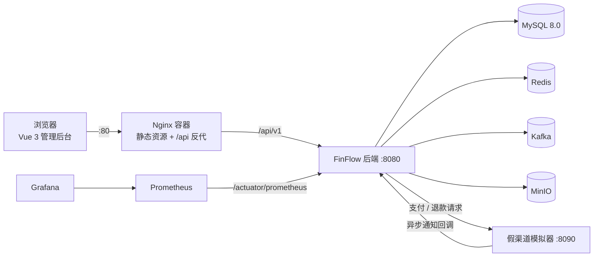

# FinFlow 企业级支付与资金结算平台

一个「模块化单体」形态的支付与资金结算后台：覆盖商户中心、支付核心（状态机 / 幂等 / 渠道路由 / 事件）、退款、账户与资金流水、清分、T+1 结算、自动对账、风控规则引擎、Webhook 通知、审计日志与运营 Dashboard。

后端 Java 25 + Spring Boot 4.1，前端 Vue 3 + TypeScript + Vite，中间件 MySQL 8.0 + Redis + Kafka + MinIO。

---

## 一、技术栈

| 层次 | 选型 |
| --- | --- |
| 后端 | Java 25 · Spring Boot 4.1 · Spring Security · MyBatis-Plus · Flyway |
| 前端 | Vue 3 · TypeScript · Vite · Pinia · Element Plus · ECharts · vue-tsc |
| 中间件 | MySQL 8.0 · Redis 7 · Kafka 4.0 · MinIO（对象存储） |
| 可观测性 | Spring Actuator · Micrometer · Prometheus · Grafana · 日志 traceId（MDC） |
| 部署 | Docker 多阶段构建 · Nginx 反代 · Docker Compose · GitHub Actions |

架构保持**模块化单体**，不引入注册中心 / 网关 / 微服务套件；模块之间只通过对方暴露的 Service 接口调用。

---

## 二、系统架构



---

## 三、模块说明

后端按业务模块划分包结构（`finflow-backend/src/main/java/org/example/finflowbackend`），每个模块内部再按 controller / service / mapper / entity 分层。

| 模块 | 职责 |
| --- | --- |
| `auth` | 登录认证、JWT + Refresh Token、RBAC 鉴权 |
| `merchant` | 商户入驻、费率、结算账户、API 密钥 |
| `payment` | 支付订单、状态机、业务幂等 / API 幂等、渠道路由、支付回调 |
| `refund` | 退款申请、退款状态流转 |
| `account` | 商户账户、余额与冻结 |
| `ledger` | 资金流水（只增不改） |
| `clearing` | 清分计算 |
| `settlement` | T+1 结算与结算单 |
| `reconciliation` | 对账任务、账单导入、差异处理 |
| `risk` | 风控规则引擎（审核 / 拒绝阈值） |
| `webhook` | 商户回调通知、签名与重试 |
| `notification` | 站内信与邮件通知中心 |
| `audit` | 操作审计日志（`@Audited` 切面） |
| `system` | 用户 / 角色 / 权限 / 菜单 / 系统配置 / Dashboard |
| `common` | 统一响应、错误码、全局异常处理、分页、公共组件 |

| 其他工程 | 说明 |
| --- | --- |
| `finflow-frontend` | Vue 3 运营管理后台 |
| `finflow-fake-channel` | 独立进程的第三方支付渠道模拟器（端口 8090），用于联调支付 / 退款 / 异步通知 |

---

## 四、快速开始

### 方式一：Docker 一键部署（推荐）

**前置要求**：Docker Desktop（含 Compose v2）。

**第 1 步：准备 MySQL 8.0**

默认复用**宿主机 MySQL**，需先建库（表结构由应用启动时的 Flyway 自动迁移，无需手工建表）：

```sql
CREATE DATABASE finflow DEFAULT CHARACTER SET utf8mb4 COLLATE utf8mb4_unicode_ci;
```

> 本机没有 MySQL？改用容器 MySQL：加上 `--profile with-mysql`，并设置 `MYSQL_HOST=mysql`，即可完全自包含启动。

**第 2 步：一键拉起全套**

```bash
docker compose -f docker-compose.prod.yml up -d --build
```

**第 3 步：访问**

* 管理后台：<http://localhost>
* Grafana：<http://localhost:3000>（admin / admin）
* Prometheus：<http://localhost:9090>

**演示账号**：`admin` / `admin123`（内置超级管理员，拥有全部权限）

> 生产部署务必通过环境变量覆盖 `FINFLOW_JWT_SECRET`、`FINFLOW_SECRET_ENCRYPT_KEY`、`MYSQL_PASSWORD`（见下文「环境变量」）。

### 方式二：本地开发

```bash
# 1) 起中间件（Redis + Kafka + MinIO + Prometheus + Grafana）
docker compose up -d

# 2) 起后端 + 前端（Windows 一键脚本）
start-dev.bat
```

或分别启动：

```bash
cd finflow-backend && ./mvnw spring-boot:run      # 后端 :8080
cd finflow-frontend && npm install && npm run dev  # 前端 :5173
cd finflow-fake-channel && mvn spring-boot:run     # 假渠道 :8090（联调渠道时启动）
```

本地开发默认 `dev` profile，连本机 MySQL（`finflow` 库）、`localhost:6379`、`localhost:9092`；前端 Vite 已配置 `/api` → `localhost:8080` 代理。

---

## 五、服务与端口

| 服务 | 端口 | 说明 |
| --- | --- | --- |
| 前端（Nginx） | 80（可用 `FRONTEND_PORT` 改） | 静态资源 + `/api` 反代 |
| 后端 | 8080 | API + Actuator |
| 假渠道模拟器 | 8090 | 渠道联调 |
| MySQL | 3306 | 宿主机实例（或 `with-mysql` 容器） |
| Redis | 6379 | 缓存 / 幂等 / 分布式锁 |
| Kafka | 9092 | 事件驱动 |
| MinIO | 9000 / 9001 | S3 API / 控制台 |
| Prometheus | 9090 | 指标 |
| Grafana | 3000 | 面板（admin / admin） |

---

## 六、环境变量（部署）

| 变量 | 默认值 | 说明 |
| --- | --- | --- |
| `MYSQL_HOST` | `host.docker.internal` | 宿主机 MySQL；用容器 MySQL 时设为 `mysql` |
| `MYSQL_PORT` | `3306` | MySQL 端口 |
| `MYSQL_DATABASE` | `finflow` | 库名（需预先存在） |
| `MYSQL_USERNAME` / `MYSQL_PASSWORD` | `root` / `2369` | **生产必须覆盖** |
| `FINFLOW_JWT_SECRET` | 开发默认值 | JWT 签名密钥，**生产必须覆盖** |
| `FINFLOW_SECRET_ENCRYPT_KEY` | 开发默认值 | 商户密钥落库加密密钥（AES-256-GCM），**生产必须覆盖** |
| `FRONTEND_PORT` | `80` | 前端对外端口 |

覆盖方式：在根目录新建 `.env.prod` 并用 `--env-file` 指定：

```bash
docker compose -f docker-compose.prod.yml --env-file .env.prod up -d --build
```

---

## 七、可观测性与接口文档

* 指标：后端 `/actuator/prometheus` 由 Prometheus 抓取，Grafana 预置「FinFlow Overview」面板（QPS / 错误率）。
* 链路：每个请求分配 `traceId`，写入日志（`%X{traceId}`）并回传 `X-Trace-Id` 响应头。
* 接口文档（仅 `dev`）：<http://localhost:8080/swagger-ui/index.html>；`prod` profile 下已关闭 Swagger UI 与 api-docs。

---

## 八、测试

```bash
cd finflow-backend && ./mvnw test        # 单测 + 集成测试（MySQL 由 Testcontainers 提供），覆盖率报告 target/site/jacoco
cd finflow-frontend && npm run test:unit  # Vitest 单测
```

CI（GitHub Actions，`.github/workflows/ci.yml`）：后端与假渠道编译测试、前端单测与构建、三个镜像的可构建性校验（不推送 registry）。

---

## 九、目录结构

```
finflow-platform/
├─ finflow-backend/         后端（Spring Boot 单体，Dockerfile 多阶段构建）
├─ finflow-frontend/        前端（Vue 3，Dockerfile + nginx.conf）
├─ finflow-fake-channel/    第三方渠道模拟器（独立进程）
├─ docker/                  Prometheus / Grafana 配置
├─ docker-compose.yml       本地开发：只起中间件
├─ docker-compose.prod.yml  一键部署：应用 + 前端 + 中间件
├─ start-dev.bat            Windows 本地开发一键启动
└─ FinFlow分步开发报告.md     分步开发执行报告（S01–S42）
```
