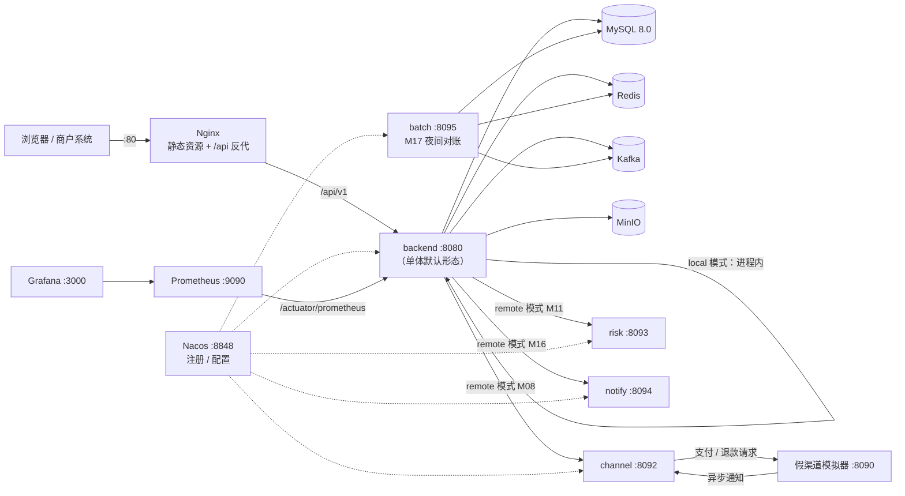

# FinFlow 企业级支付与资金结算平台

一个「模块化单体 + 可选微服务演进」形态的支付与资金结算后台：覆盖商户中心、支付核心（状态机 / 幂等 / 渠道路由 / 事件）、退款、账户与资金流水、清分、T+1 结算、自动对账、风控规则引擎、Webhook 通知、审计日志与运营 Dashboard。

默认单进程即可跑通全部业务；M08–M17 提供「渠道 / 风控 / 通知 / 批处理」四个可独立部署的进程和开放平台网关，全部通过开关回退到单体，不改变任何业务语义。

后端 Java 25 + Spring Boot 4.1，前端 Vue 3 + TypeScript + Vite，中间件 MySQL 8.0 + Redis + Kafka + MinIO，可选 Nacos + Sentinel。

---

## 一、技术栈

| 层次 | 选型 |
| --- | --- |
| 后端 | Java 25 · Spring Boot 4.1 · Spring Security · MyBatis-Plus · Flyway |
| 前端 | Vue 3 · TypeScript · Vite · Pinia · Element Plus · ECharts · vue-tsc |
| 中间件 | MySQL 8.0 · Redis 7 · Kafka 4.0 · MinIO（对象存储） |
| 服务治理（可选） | Nacos 3.1（注册 / 配置）· Sentinel 1.8.8（流控 / 熔断）· OpenFeign |
| 可观测性 | Spring Actuator · Micrometer · Prometheus · Grafana · 日志 traceId（MDC） |
| 部署 | Docker 多阶段构建 · Nginx 反代 · Docker Compose · GitHub Actions |

模块之间只通过对方暴露的 Service 接口调用（见 `ModuleBoundaryTest`）。跨进程调用统一走 Feign + 降级，不存在跨库 JOIN。

---

## 二、系统架构



* **默认形态（本地开发 / 单机部署）**：只有 `backend :8080` 一个进程，渠道、风控、通知、对账全部在进程内执行（`finflow.channel.mode=local` / `risk.mode=local` / `notify.mode=local`）。
* **拆分布形态**：同一份镜像按 profile 启动 `channel` / `risk` / `notify` / `batch`，各自独立端口、独立 Nacos 注册、独立 Sentinel transport 端口；backend 通过 `*_MODE=remote` 走 Feign，或把 `FINFLOW_BATCH_WORKER` / `FINFLOW_NOTIFY_WORKER` 置 `false` 交接后台任务。
* **回退**：任一拆分只改环境变量即可回到单体，代码路径不变。

---

## 三、模块说明

后端按业务模块划分包结构（`finflow-backend/src/main/java/org/example/finflowbackend`），每个模块内部再按 controller / service / mapper / entity 分层。

| 模块 | 职责 |
| --- | --- |
| `auth` | 登录认证、JWT + Refresh Token、RBAC 鉴权、图形验证码 |
| `merchant` | 商户入驻、费率、结算账户、API 密钥、OpenAPI 配额 |
| `payment` | 支付订单、状态机、业务幂等 / API 幂等、支付回调业务编排（渠道协议细节在 `channel`）|
| `channel` | 渠道 SPI 与路由、渠道调用与 HMAC 签名、回调验签与解析、渠道配置与交互记录（M08 可独立进程）|
| `openapi` | 商户 OpenAPI（AK/SK 验签 / 时间戳窗口 / nonce 防重放 / QPS 配额）|
| `refund` | 退款申请、退款状态流转 |
| `account` | 商户账户、余额与冻结 |
| `ledger` | 资金流水（只增不改）|
| `clearing` | 清分计算 |
| `settlement` | T+1 结算与结算单、每日生成任务 |
| `reconciliation` | 对账任务、账单导入、差异处理、夜间自动匹配（M17 可独立进程）|
| `risk` | 风控规则引擎（审核 / 拒绝阈值、超时降级）（M11 可独立进程）|
| `webhook` | 商户回调通知、签名与重试（Kafka 异步投递）|
| `notification` | 站内信与邮件通知中心（Kafka 异步消费）|
| `notify` | 通知服务进程内的投影与内部端点（M16）|
| `audit` | 操作审计日志（`@Audited` 切面）|
| `system` | 用户 / 角色 / 权限 / 菜单 / 系统配置 / Dashboard |
| `contract` | Kafka 事件契约：topic 常量、事件信封、payload（语义只增不改）|
| `common` | 统一响应、错误码、全局异常处理、分页、幂等、限流、运行时配置 |

| 其他工程 | 说明 |
| --- | --- |
| `finflow-frontend` | Vue 3 运营管理后台 |
| `finflow-fake-channel` | 独立进程的第三方支付渠道模拟器（8090），支持延迟异步通知、失败率、重复通知 |
| `finflow-gateway` | 开放平台网关（M01 起，8091），当前为空骨架，只验证 Nacos 注册与 Sentinel 上报 |
| `finflow-backend` 多 profile | `channel`(8092) / `risk`(8093) / `notify`(8094) / `batch`(8095)，与 backend 同一份源码与镜像 |

---

## 四、快速开始

### 方式一：Docker 一键部署（推荐）

**前置要求**：Docker Desktop（含 Compose v2）。

**第 1 步：准备 MySQL 8.0**

默认复用**宿主机 MySQL**，需先建库（表结构由应用启动时的 Flyway 自动迁移，无需手工建表）：

```sql
CREATE DATABASE finflow DEFAULT CHARACTER SET utf8mb4 COLLATE utf8mb4_unicode_ci;
```

> 本机没有 MySQL？改用容器 MySQL：加上 `--profile with-mysql`，并设置 `MYSQL_HOST=mysql`，即可完全自包含启动。

**第 2 步：一键拉起全套**

```bash
docker compose -f docker-compose.prod.yml up -d --build
```

一次构建产出 5 个可执行 jar（backend / channel / risk / notify / batch），按 `target` 阶段复用到 5 个镜像。

**第 3 步：访问**

* 管理后台：<http://localhost>
* Grafana：<http://localhost:3000>（admin / admin）
* Prometheus：<http://localhost:9090>

**演示账号**：`admin` / `admin123`（内置超级管理员，拥有全部权限）

> 生产部署务必通过环境变量覆盖 `FINFLOW_JWT_SECRET`、`FINFLOW_SECRET_ENCRYPT_KEY`、`MYSQL_PASSWORD`（见下文「环境变量」）。

### 方式二：本地开发

```bash
# 1) 起中间件（Redis + Kafka + MinIO + Prometheus + Grafana + Nacos + Sentinel 控制台）
docker compose up -d

# 2) 起后端 + 前端（Windows 一键脚本）
start-dev.bat
```

或分别启动：

```bash
cd finflow-backend && ./mvnw spring-boot:run      # 后端 :8080（默认 dev profile）
cd finflow-frontend && npm install && npm run dev  # 前端 :5173
cd finflow-fake-channel && mvn spring-boot:run     # 假渠道 :8090（联调渠道时启动）
```

本地开发默认 `dev` profile，连本机 MySQL（`finflow` 库）、`localhost:6379`、`localhost:9092`；前端 Vite 已配置 `/api` → `localhost:8080` 代理。

拆分进程本地启动（先 `mvn package`）：

```bash
java -jar finflow-backend/target/*-channel.jar --spring.profiles.active=channel   # 8092
java -jar finflow-backend/target/*-risk.jar    --spring.profiles.active=risk      # 8093
java -jar finflow-backend/target/*-notify.jar  --spring.profiles.active=notify    # 8094
java -jar finflow-backend/target/*-batch.jar   --spring.profiles.active=batch     # 8095
```

> 独立进程需加 `-DJM.LOG.PATH` / `-Dcsp.sentinel.log.dir`，否则 Nacos / Sentinel 默认往 `~/logs` 写，受限目录下会启动失败。

---

## 五、服务与端口

| 服务 | 端口 | 说明 |
| --- | --- | --- |
| 前端（Nginx） | 80（可用 `FRONTEND_PORT` 改） | 静态资源 + `/api` 反代 |
| 后端 backend | 8080 | API + Actuator（会话 / 支付 / 清分 / 结算 / 对账） |
| 假渠道模拟器 | 8090 | 渠道联调（延迟通知、失败率、重复通知可配） |
| 网关 gateway | 8091 | 空骨架（M01），商户 OpenAPI 从 M13 接入 |
| 渠道服务 channel | 8092 | M08，`FINFLOW_CHANNEL_MODE=remote` 时由 backend 调用 |
| 风控服务 risk | 8093 | M11，`FINFLOW_RISK_MODE=remote` 时由 backend 调用 |
| 通知服务 notify | 8094 | M16，Webhook / 站内信 / 邮件异步消费 |
| 批处理服务 batch | 8095 | M17，夜间对账自动匹配 |
| Nacos | 8848 / 9848 / 9849 | 注册中心（客户端 gRPC 需 9848、9849） |
| Nacos 控制台 | 8081 | 服务列表 / 配置 |
| Sentinel 控制台 | 8858 | 流控与熔断（sentinel / sentinel） |
| MySQL | 3306 | 宿主机实例（或 `with-mysql` 容器） |
| Redis | 6379 | 缓存 / 幂等 / 分布式锁 / 限流 |
| Kafka | 9092 | 事件驱动（支付成功、对账异常、商户通知配置变更等） |
| MinIO | 9000 / 9001 | S3 API / 控制台（文件中心、对账账单） |
| Prometheus | 9090 | 指标（backend / channel / risk / notify / batch 各自一个 job） |
| Grafana | 3000 | 面板（admin / admin） |

Sentinel transport 端口按进程错开：backend 8719 / channel 8720 / risk 8721 / notify 8723 / batch 8724。

---

## 六、环境变量（部署）

| 变量 | 默认值 | 说明 |
| --- | --- | --- |
| `MYSQL_HOST` | `host.docker.internal` | 宿主机 MySQL；用容器 MySQL 时设为 `mysql` |
| `MYSQL_PORT` | `3306` | MySQL 端口 |
| `MYSQL_DATABASE` | `finflow` | 库名（需预先存在） |
| `MYSQL_USERNAME` / `MYSQL_PASSWORD` | `root` / `2369` | **生产必须覆盖** |
| `FINFLOW_JWT_SECRET` | 开发默认值 | JWT 签名密钥，**生产必须覆盖** |
| `FINFLOW_SECRET_ENCRYPT_KEY` | 开发默认值 | 商户密钥 / Webhook 密文加密密钥（AES-256-GCM），**生产必须覆盖** |
| `FINFLOW_INTERNAL_TOKEN` | 开发默认值 | 网关 ↔ backend 内部令牌，**生产必须覆盖** |
| `FRONTEND_PORT` | `80` | 前端对外端口 |
| `FINFLOW_CHANNEL_MODE` | `local` | `local`=渠道能力进程内；`remote`=调 channel :8092 |
| `FINFLOW_RISK_MODE` | `local` | `local`=风控进程内；`remote`=调 risk :8093 |
| `FINFLOW_NOTIFY_MODE` | `local` | `local`=通知能力进程内；`remote`=调 notify :8094 |
| `FINFLOW_NOTIFY_WORKER` | `true` | Webhook 投递 / 通知消费开关；拆出后 backend 置 `false` |
| `FINFLOW_BATCH_WORKER` | `true` | 对账夜间匹配任务开关；拆出后 backend 置 `false` |
| `NACOS_SERVER_ADDR` | `127.0.0.1:8848` | 拆分进程必填（compose 内为 `nacos:8848`） |
| `SENTINEL_DASHBOARD` | `127.0.0.1:8858` | 拆分进程必填（compose 内为 `sentinel-dashboard:8858`） |
| `FINFLOW_CHANNEL_BASE_URL` | `http://localhost:8090` | 下游渠道基址（本地为假渠道） |
| `FINFLOW_CHANNEL_SECRET` | 开发默认值 | 渠道签名共享密钥，与假渠道同值 |

覆盖方式：在根目录新建 `.env.prod` 并用 `--env-file` 指定：

```bash
docker compose -f docker-compose.prod.yml --env-file .env.prod up -d --build
```

---

## 七、可观测性与接口文档

* 指标：各进程 `/actuator/prometheus` 由 Prometheus 抓取（`finflow-backend` / `finflow-channel` / `finflow-risk` / `finflow-notify` / `finflow-batch` 五个 job），Grafana 预置「FinFlow Overview」面板（QPS / 错误率），指标统一带 `application` 标签。
* 链路：每个请求分配 `traceId`，写入日志（`%X{traceId}`）并回传 `X-Trace-Id` 响应头；跨进程事件经 Kafka 透传。
* 接口文档（仅 `dev`）：<http://localhost:8080/swagger-ui/index.html>；`prod` profile 下已关闭 Swagger UI 与 api-docs。
* 商户 OpenAPI：`/open/v1/**`，AK/SK 签名（`X-Api-Key` / `X-Timestamp` / `X-Nonce` / `X-Signature`），写接口需 `Idempotency-Key`。

---

## 八、测试

```bash
cd finflow-backend && ./mvnw test        # 单测 + 集成测试（MySQL 由 Testcontainers 提供），覆盖率报告 target/site/jacoco
cd finflow-frontend && npm run test:unit  # Vitest 单测
```

CI（GitHub Actions，`.github/workflows/ci.yml`）：后端与假渠道编译测试、前端单测与构建、镜像可构建性校验（不推送 registry）。

---

## 九、压测与数据快照

仓库内的演示数据由一次**完整下单链路压测**重建（2026-11-01，本机单实例）。

| 环节 | 结果 |
| --- | --- |
| 下单（`POST /open/v1/payments`，AK/SK 签名 + 幂等键 + 渠道受理 + 异步回调） | 5000 笔，并发 40，耗时 12.7s，**393.7 QPS**，平均 100ms / P95 134ms / P99 215ms，成功率 100% |
| 异步回调落状态 | 4994 笔 `PAID`（99.88%），6 笔回调丢失保持 `PENDING`（模拟真实未支付订单） |
| 查询（`GET /api/v1/payments/orders`，后台 JWT） | 30s 压测 **108,083 次请求 / 3,602 QPS**，平均 10.6ms / P95 17ms / P99 24ms，0 失败 |

压测后库内数据量：`payment_order` 5000 笔（支付金额合计 ¥2,522,816.00）、`account_ledger` 4994 行、`clearing_order` 4994 笔、`clearing_detail` 14,982 行；对账 / 结算 / 通知表为空（等待夜间任务或手工触发）。

压测环境与做法：

* backend（8080，dev profile）+ 假渠道模拟器（8090）+ 本机 MySQL / Redis / Kafka。
* 假渠道为压测临时关闭通知间隔（`--finflow.fake-channel.notify-gap-seconds=0 --finflow.fake-channel.pay-delay-seconds=2`）；默认 `notify-gap-seconds=1` 时通知单线程串行，约 1 笔/秒，只适合联调不适合批量造数。
* 压测走商户 OpenAPI（默认配额 20 QPS/接口），压测期间临时把 `PAYMENT_CREATE` 配额调到 2000 QPS，结束后已恢复默认、并回收了临时 API 密钥。
* 历史业务数据在压测前已备份（`finflow-backend/target/verify/loadtest/backup-before-loadtest.sql`）；商户、密钥、费率、权限、系统配置等主数据保持不变。

---

## 十、目录结构

```
finflow-platform/
├─ finflow-backend/         后端（模块化单体；同源多 profile 产出 backend/channel/risk/notify/batch）
├─ finflow-frontend/        前端（Vue 3，Dockerfile + nginx.conf）
├─ finflow-fake-channel/    第三方渠道模拟器（独立进程）
├─ finflow-gateway/         开放平台网关骨架（8091）
├─ docker/                  Prometheus / Grafana / Maven 镜像配置
├─ docker-compose.yml       本地开发：只起中间件
├─ docker-compose.prod.yml  一键部署：应用 + 前端 + 中间件
├─ start-dev.bat            Windows 本地开发一键启动
├─ FinFlow分步开发报告.md    分步开发执行报告（S01–S42）
└─ FinFlow微服务演进执行报告.md  微服务演进执行报告（M01–M17）
```
